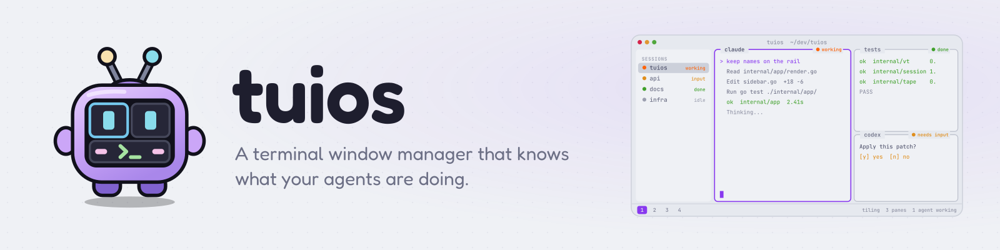
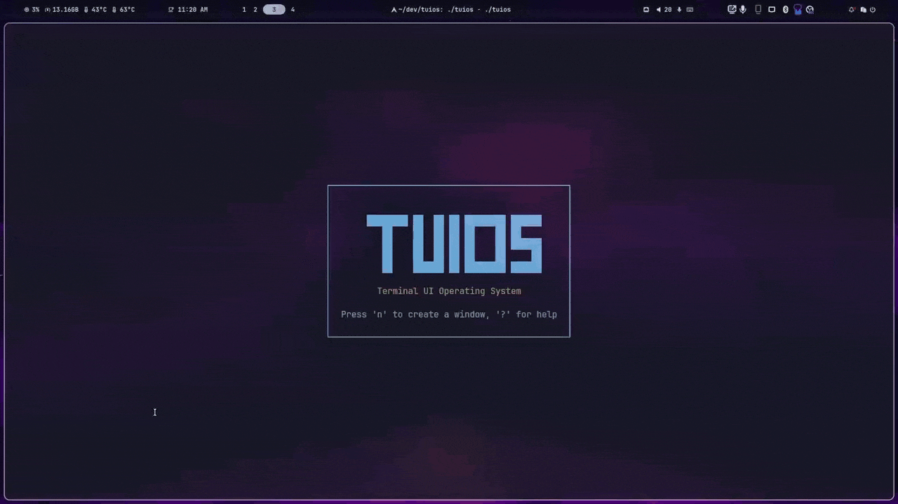
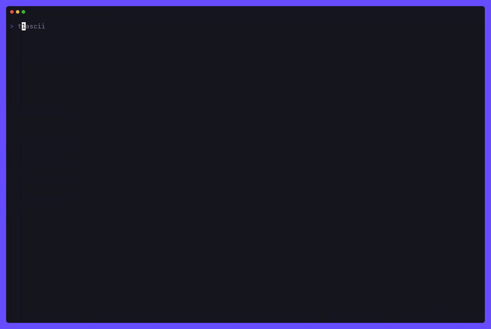

> [!WARNING]
> **An account on X called @tuiosdev is pretending to be tuios. It is not this project.** tuios has no X or Twitter account. It lives only at [tuios.dev](https://tuios.dev) and in this repository. There is no tuios token or presale. Please report that account if you see it.

<div align="center">
  <picture>
    <source media="(prefers-color-scheme: dark)" srcset="./assets/brand/banner-dark.png">
    <source media="(prefers-color-scheme: light)" srcset="./assets/brand/banner-light.png">
    
  </picture>

  <p><strong>TUIOS: Terminal UI Operating System</strong></p>

  <a href="https://github.com/Gaurav-Gosain/tuios/releases"></a>
  <a href="https://pkg.go.dev/github.com/Gaurav-Gosain/tuios?tab=doc"></a>
  <a href="https://deepwiki.com/Gaurav-Gosain/tuios"></a>
  <br>
  <a title="This tool is Tool of The Week on Terminal Trove, The $HOME of all things in the terminal" href="https://terminaltrove.com/"></a>
</div>

<picture>
  <source srcset="./assets/demo.avif" type="image/avif">
  
</picture>

TUIOS is a modern terminal multiplexer and window manager built with Go. It provides a vim-like modal interface with multiple terminal panes, workspaces, BSP tiling, kitty graphics protocol support, and a command palette, all running inside your existing terminal. A daemon keeps sessions alive, reaches sessions on your other machines, and lets the coding agents in your panes report their state and message each other.

Built on the Charm stack (Bubble Tea v2, Lipgloss v2), TUIOS features event-driven rendering for near-zero idle CPU usage, flicker-free kitty image passthrough, and comprehensive keyboard/mouse interaction.

## Documentation

Full documentation is available at **[tuios.dev](https://tuios.dev)** (hosted) or in the [`docs/`](./docs/) folder. To try tuios without installing it, take the guided tour at **[tuios.dev/learn](https://tuios.dev/learn)**: the real app, compiled to WebAssembly, with a practice shell in every pane.

What changed in v0.10.1 is in the [release notes](docs/release-notes/v0.10.1.md).

### Quick Links
- **[Getting Started](https://tuios.dev/docs/getting-started)**: Install and first session
- **[Keybindings](docs/KEYBINDINGS.md)**: Default keys and how to rebind them
- **[BSP Tiling](docs/BSP_TILING.md)**: Tiling with preselection and split control
- **[Layout Modes](docs/LAYOUT_MODES.md)**: BSP, master-stack and scrolling layouts, aggregate view, multifocus
- **[Configuration](docs/CONFIGURATION.md)**: Customize keybindings, themes, and behavior
- **[Hooks](docs/HOOKS.md)**: Run shell commands on window, session and agent events
- **[Themes](docs/THEMES.md)**: Built-in themes and custom theme JSON
- **[Glyph sets](docs/GLYPHS.md)**: The characters the chrome is drawn with
- **[CLI Reference](docs/CLI_REFERENCE.md)**: All command-line options
- **[Tape Scripting](docs/TAPE_SCRIPTING.md)**: Automate workflows
- **[Sessions](docs/SESSIONS.md)**: Daemon mode, attach/detach, other machines, and what survives
- **[Agents](docs/AGENT_STATE.md)**: Running coding agents in tuios: state, the Inbox, approvals, fleets, other machines, grants and MCP
- **[Program Status](docs/PROGRAM_STATUS.md)**: OSC 7501 from any program, `tuios status`, and the reports tuios sends to its own terminal
- **[tmux Shim](docs/TMUX_SHIM.md)**: Run tools that drive tmux, such as Claude Code agent teams
- **[Control Protocol](docs/protocol.md)**: JSON verb protocol for driving the daemon
- **[Architecture](docs/ARCHITECTURE.md)**: Technical design

<details>
<summary>Table of Contents</summary>

<!--toc:start-->
- [Installation](#installation)
- [Features](#features)
- [Quick Start](#quick-start)
- [Architecture](#architecture)
- [Performance](#performance)
- [Development](#development)
- [Contributors](#contributors)
- [License](#license)
<!--toc:end-->

</details>

## Installation

### Package Managers

**Homebrew (macOS/Linux):**
```bash
brew install tuios
```

**Homebrew, ghostty build (Linux only):** `tuios` built with the [libghostty-vt emulator](./docs/ghostty-vt.md). It installs a binary with the same name as the `tuios` formula. Uninstall the formula first.
```bash
brew uninstall tuios
brew install gaurav-gosain/tap/tuios-ghostty
```

**Arch Linux (AUR):**
```bash
yay -S tuios-bin
```

**Nix:**
```bash
nix run github:Gaurav-Gosain/tuios/v0.10.1#tuios   # a release
nix run github:Gaurav-Gosain/tuios#tuios          # the latest main
nix run nixpkgs#tuios                             # the nixpkgs package
```

Put a release tag after the repo name to build that release. Without a tag, Nix builds the newest commit on `main`.

### Other Methods

```bash
# Quick install script (Linux/macOS)
curl -fsSL https://raw.githubusercontent.com/Gaurav-Gosain/tuios/main/install.sh | bash

# Go install
go install github.com/Gaurav-Gosain/tuios/cmd/tuios@latest

# Docker
docker run -it --rm ghcr.io/gaurav-gosain/tuios:latest
```

**[GitHub Releases](https://github.com/Gaurav-Gosain/tuios/releases)**: Pre-built binaries for Linux, macOS, Windows, FreeBSD and OpenBSD, with a `checksums.txt`. The `tuios-ghostty_*` archives are `tuios` built on the [libghostty-vt emulator](./docs/ghostty-vt.md), for Linux, macOS and Windows on amd64 and arm64.

**Building from source** needs Go 1.26.8 or newer.

**Updating.** If you installed with the quick install script or a release
binary, `tuios update` fetches the newest release and puts it in place
(`tuios update --check` just reports). Everything else has a package manager
that owns the binary, so use that instead; `tuios update` detects which you have
and prints the right command rather than overwriting it.

### Shell Completions

`tuios completion <shell>` prints a completion script for bash, zsh, fish or
PowerShell. Besides subcommands and flags, it completes values such as session
names for `--session` and configured hosts for `--host`.

```bash
# Bash (needs the bash-completion package)
tuios completion bash > ~/.local/share/bash-completion/completions/tuios

# Zsh (the directory must be on your $fpath, before compinit runs)
tuios completion zsh > "${fpath[1]}/_tuios"

# Fish
tuios completion fish > ~/.config/fish/completions/tuios.fish
```

```powershell
# PowerShell: add this line to your $PROFILE
tuios completion powershell | Out-String | Invoke-Expression
```

Start a new shell afterwards. Run `tuios completion <shell> --help` for more
options, or see the [CLI reference](docs/CLI_REFERENCE.md#tuios-completion).

**Requirements:** A terminal with true color support. Kitty graphics and sixel support recommended (Ghostty, Kitty, WezTerm).

## Features



<table>
  <tr>
    <td width="50%"><a href="https://tuios.dev/docs/layout-modes"></a><br><b>Panes and the rail.</b> Tiled panes, and every agent's state at a glance.</td>
    <td width="50%"><a href="https://tuios.dev/docs/agent-inbox"></a><br><b>The Inbox.</b> Everything your agents wait on, in one list.</td>
  </tr>
  <tr>
    <td width="50%"><a href="https://tuios.dev/docs/agent-inbox#reviewing-an-agents-changes"></a><br><b>Review.</b> Read an agent's changes and send notes back to it.</td>
    <td width="50%"><a href="https://tuios.dev/docs/configuration"></a><br><b>Settings.</b> Every option on one page, applied at once.</td>
  </tr>
</table>

Each picture is a capture that tuios made of itself. Click one to read its docs page.

### Core
- **Multiple Terminal Panes**: Create, resize, drag, and organize terminal sessions
- **9 Workspaces**: Independent workspace isolation with instant switching
- **Modal Interface**: Vim-inspired Window Management and Terminal modes
- **Command Palette**: Fuzzy-searchable action launcher (<kbd>Ctrl</kbd>+<kbd>P</kbd>)
- **Launcher**: Fuzzy search everything on `$PATH` plus your installed desktop apps (<kbd>Alt</kbd>+<kbd>Space</kbd>), ranked by what you actually run. <kbd>Enter</kbd> starts it; <kbd>Tab</kbd> opens a shell with the command typed but not entered, so you can add arguments. App icons are drawn where the terminal supports kitty graphics.
- **Pane Zoom**: Zoom any pane with <kbd>z</kbd> (WM mode) or <kbd>Prefix</kbd>+<kbd>z</kbd>. It takes 95% of the screen by default; set `appearance.zoom_size = 100` for fullscreen. A fullscreen zoom hides the shared borders, and the dockbar shows a **Z** indicator.
- **Session Rail**: A sidebar with sessions, terminals, files, git state and agents, on by default on the right (`appearance.sidebar.enabled`)
- **Settings Page**: Change options in the app with <kbd>Prefix</kbd>+<kbd>,</kbd>
- **Popups**: `tuios popup -- fzf` runs a command in a floating pane that closes when it exits

### Agents
The guide is [docs/AGENT_STATE.md](docs/AGENT_STATE.md).
- **Agent State**: Panes running a coding agent show whether it is working, waiting for you, done or errored, as a shape in the title and a row on the rail. `tuios integration install` wires 19 harnesses (Claude Code, Codex, Gemini CLI, opencode and more) to report it, and tuios detects 24 agent CLIs by their process and screen
- **Program Status (OSC 7501)**: Any program can say what it is doing with the Program Status Protocol, or with `tuios status working --app build --progress 40`. A build, a deploy script or `brew` then shows on the rail and in the Inbox like an agent. tuios also reports its panes to a terminal that reads the protocol, such as Rex ([docs](docs/PROGRAM_STATUS.md))
- **Inbox**: <kbd>Prefix</kbd>+<kbd>i</kbd> lists everything waiting for you in every session and on every machine: approvals, questions, mail, errors, finished turns. <kbd>Prefix</kbd>+<kbd>o</kbd> jumps to the oldest. Answer a prompt from there without going to the pane, and with `[agents.approvals]` answer Claude Code, opencode, Kilo and Qwen Code permission requests with one key
- **Questions and Messages**: `tuios ask-human` puts a question with fixed answers in your Inbox. Agents mail each other with `tuios send-agent-message`, and `tuios ask-agent` asks one and waits for its answer. It never types into a pane waiting on a prompt, and replies from you are marked verified
- **Fleets**: `tuios fan` starts one prompt in several agents, mixed harnesses allowed, each in its own git worktree. `tuios start-agent` starts one helper beside you, in its TUI or headless over ACP or the Codex app-server. Selectors such as `group:fan/retry needs:you` address a whole group
- **Resume**: After a daemon restart, the Inbox offers to resume each agent conversation that was running
- **Pane Grants**: Say what an agent's pane may do through tuios (`read`, `write`, `fan`, `respond`, `admin`), and give a helper less with `--grants`
- **MCP Server**: `tuios mcp` serves the same surface as MCP tools, read-only and held to the agent's own session unless you say otherwise
- **tmux Shim**: `tuios tmux-shim` runs tools that drive tmux, such as Claude Code agent teams, with their panes opened as tuios panes
- **Session Stash**: `tuios stash put` keeps a file for the session, so another agent can still open it
- **Agent Skill**: `tuios --skill` prints the short guide an agent in a pane reads to drive tuios, and `tuios --skill TOPIC` the rest, recipes included

### Machines
- **Hosts**: `tuios hosts add` names another machine, reached over ssh. `tuios hosts tailnet` lists the machines on a Tailscale tailnet
- **Remote Sessions**: `tuios attach --host build api` draws a session on another machine in this client, and `-s HOST:SESSION` sends any command there
- **Hosted Panes**: `tuios new-window NAME --host build` runs one pane's process on another machine, in a session here
- **Global Sessions**: `tuios new NAME --global` holds panes from several machines ([docs](docs/SESSIONS.md))
- **Agents on Other Machines**: `tuios fan --host build` and `tuios start-agent -s build:api` run agents there, their Inbox items show here, and `tuios worktree pull` brings their work back. Each machine's `[hosts]` policy says what the others may do

### Tiling
- **BSP Tiling**: Binary Space Partitioning with spiral layout
- **Scrolling Layout**: niri-style columns on an infinite horizontal strip ([docs](docs/LAYOUT_MODES.md))
- **Master-Stack Layout**: One master pane with the rest stacked beside it
- **Smart Auto-Split**: Aspect-ratio-aware splitting (opt-in)
- **Shared Borders**: tmux-style separator lines between panes (`--shared-borders`)
- **Preselection**: Control where the next pane spawns
- **Equalize Splits**: Reset all splits to balanced ratios

### Scrollback & Copy Mode
- **Vim-Style Copy Mode**: Navigate 10,000-line scrollback with hjkl, search down with `/` and up with `?`, yank with `y`
- **Multi Copy Mode**: Copy mode on every pane of the multifocus set at once. Search once, select with `v`/`V` in each pane, and yank all selections as plain text, markdown or JSON, to the clipboard or a file ([docs](docs/LAYOUT_MODES.md#multi-copy-mode))
- **Mouse Wheel Scrollback**: The wheel scrolls history with no mode entered; typing or reaching the bottom returns to live output
- **Interactive Scrollbar**: Click or drag the right border to jump to scroll position
- **Selection Auto-Scroll**: Drag selection above/below pane to scroll
- **Scrollback Browser**: OSC 133-aware command/output block navigation
- **Scroll Position Indicator**: Shows offset/total on the bottom border

### Graphics & Protocols
- **Kitty Graphics Protocol**: Full image rendering with flicker-free video playback. `mpv --vo=kitty` works (both shm and base64), and [youterm](https://github.com/Gaurav-Gosain/youterm) works.
- **Sixel Graphics**: Sixel image passthrough (experimental, no pixel-level clipping yet)
- **Kitty Keyboard Protocol**: Progressive enhancement (CSI u) with push/pop/query support. Fish 4.x compatible; Shift+printable bypasses the protocol and sends text directly.
- **Synchronized Output**: Mode 2026 prevents screen tearing
- **Shared Memory Support**: `t=s` passthrough for mpv `--vo-kitty-use-shm`
- **Animation Frames**: A guest's `a=f` frame edits are forwarded to the host, so a program that patches its own image costs a rectangle instead of a whole bitmap. TUIOS also patches guests that only retransmit. Panes are told whether the host carries frame edits through `TUIOS_KITTY_ANIMATION`, because the host's reply is not relayed back into the pane and a guest cannot find out for itself.
- **Terminal Queries**: OSC 4 palette, OSC 10-12 colors, CSI 14/16/18t sizing, DA1/DA2
- **Experimental**: Kitty text sizing protocol (OSC 66). Basic passthrough works but has known issues with scrollback and window repositioning
- **Kitty Animation Protocol**: Frame transmission, composition, and control (a=f, a=a, a=c), with damage-patch streaming for animated guests

### Session Management
- **Daemon Mode**: Persistent sessions with detach/reattach (like tmux)
- **Session Resurrection**: Sessions come back after a daemon restart or reboot with their structure and working directories ([docs](docs/SESSIONS.md))
- **Session Switcher**: In-app session list (<kbd>Prefix</kbd>+<kbd>S</kbd>)
- **Layout Templates**: Save/load window arrangements with working directories and startup commands
- **Layout CLI**: `tuios layout list`, `tuios layout delete`, `tuios layout export`

### Automation
- **Tape Scripting**: DSL for recording and replaying terminal workflows
- **Tape Recording**: Record live sessions (<kbd>Prefix</kbd>+<kbd>T</kbd> <kbd>r</kbd>)
- **Headless Execution**: `tuios tape exec` runs a tape against a running daemon session
- **Layout Export**: Convert layouts to tape scripts for sharing

### Discovery & Navigation
- **Which-Key Popup**: Hold the prefix key to see the chords available (`appearance.whichkey_enabled`, [docs](docs/KEYBINDINGS.md))
- **App Launcher**: <kbd>Alt</kbd>+<kbd>Space</kbd> runs anything on `$PATH`, frecency-ranked, with desktop-entry names and icons
- **Keybind Manager**: <kbd>Prefix</kbd>+<kbd>k</kbd> in-app, or `tuios keybinds doctor` and `tuios keybinds explain <key>` from the shell
- **Aggregate View**: Searchable list of every window across every workspace, with previews ([docs](docs/LAYOUT_MODES.md#aggregate-view))
- **Multifocus**: Broadcast typing to several panes at once, `Ctrl`+`Shift`+click to select ([docs](docs/LAYOUT_MODES.md#multifocus))

### More
- **Showkeys Overlay**: Display pressed keys for presentations
- **Spotlight**: Light one area of the screen and dim the rest, for demos and recordings (`[spotlight]` config table)
- **Screenshots**: `tuios screenshot` renders a pane to PNG, SVG, ANSI, HTML or text
- **Dock Components**: Your own commands drawn in the dock, updated on events, from a running command, or by polling ([examples](examples/dock/README.md))
- **Customizable Keybindings**: TOML configuration with Kitty protocol support
- **Hooks**: Run shell commands on ten events, including window, workspace, attach and agent state changes ([docs](docs/HOOKS.md))
- **Mouse Support**: Wheel scrollback, drag-to-select with copy on release, double-click word and triple-click line, window drag, resize, scrollbar
- **SSH Server Mode**: Remote terminal multiplexing
- **Web Terminal Mode**: Browser-based access (separate `tuios-web` binary)
- **Themes**: Bundled themes plus custom themes from JSON, with chrome designed for truecolor, 256 and 16 colours and for light themes ([docs](docs/THEMES.md))
- **Host Colours**: tuios asks your terminal for its colours, passes them to programs that ask, and follows its light and dark switch
- **Backgrounds**: `appearance.background` paints empty cells with the theme's background or a colour of your own, per surface if you like
- **Motion**: `appearance.motion` is `none`, `basic` or `full` (fades, the working shimmer, confetti)
- **Glyph Sets**: Choose the characters the chrome is drawn with ([docs](docs/GLYPHS.md))

## Quick Start

```bash
tuios                    # Launch TUIOS
tuios --show-keys        # Launch with key overlay for learning
tuios --standalone       # Launch without the daemon, for this run only
```

`tuios` attaches to a daemon-backed session, so the session outlives the
terminal window it started in. New panes are tiled. See
[SESSIONS.md](docs/SESSIONS.md) to turn either off.

### Essential Keys

| Key | Action |
|-----|--------|
| <kbd>Ctrl</kbd>+<kbd>P</kbd> | **Command palette**: search and run any action |
| <kbd>Alt</kbd>+<kbd>Space</kbd> | **Launcher**: search and start a program (<kbd>Enter</kbd> runs it, <kbd>Tab</kbd> types it out) |
| <kbd>n</kbd> | New pane (Window Management mode) |
| <kbd>i</kbd> / <kbd>Enter</kbd> | Enter Terminal mode |
| <kbd>Prefix</kbd>+<kbd>Esc</kbd> or <kbd>Alt</kbd>+<kbd>Esc</kbd> | Back to Window Management mode (a bare <kbd>Esc</kbd> goes to the shell) |
| <kbd>Prefix</kbd>+<kbd>d</kbd> | Detach in a daemon session, otherwise back to Window Management mode |
| <kbd>z</kbd> (WM) or <kbd>Prefix</kbd>+<kbd>z</kbd> | Toggle pane zoom |
| <kbd>Prefix</kbd>+<kbd>Space</kbd> | Toggle BSP tiling |
| <kbd>Prefix</kbd>+<kbd>[</kbd> | Enter copy mode (vim scrollback) |
| <kbd>Prefix</kbd>+<kbd>S</kbd> | Session switcher |
| <kbd>Prefix</kbd>+<kbd>L</kbd> then <kbd>l</kbd>/<kbd>s</kbd> | Load/Save layout template |
| <kbd>Prefix</kbd>+<kbd>?</kbd> | Help overlay |
| <kbd>Prefix</kbd>+<kbd>q</kbd> | Quit |

The **prefix key** is <kbd>Ctrl</kbd>+<kbd>B</kbd> by default (configurable).

### Daemon Mode

```bash
tuios new mysession          # Create persistent session
tuios attach mysession       # Reattach
tuios ls                     # List sessions
tuios kill-session mysession # Kill session
```

### Layout Templates

```bash
# In-app: Ctrl+B, L, l to load / Ctrl+B, L, s to save
# Or via command palette: Ctrl+P → "Save layout" / "Load layout"

# CLI:
tuios layout list            # List saved layouts
tuios layout delete mysetup  # Delete a layout
tuios layout export mysetup  # Export as tape script
```

### Configuration

```bash
tuios config edit            # Edit config in $EDITOR
tuios keybinds list          # View the common keybindings
```

See the [configuration reference](https://tuios.dev/docs/configuration) (or run `tuios list-options`) for all options including `show_clock`, `show_cpu`, `show_ram`, `shared_borders`, `window_button_style`, `window_button_position`, custom themes, and keybinding customization.

## Architecture

TUIOS follows the Model-View-Update pattern on Bubble Tea v2. For details, see [Architecture Guide](docs/ARCHITECTURE.md).

**Key design decisions:**
- **Event-driven rendering**: PTY reader goroutines signal bubbletea via a buffered channel. No fixed-rate ticking for terminal content.
- **Kitty graphics passthrough**: Image IDs are reused across frames for flicker-free video. Output is batched with the render cycle and wrapped in mode 2026 sync.
- **BSP tiling**: Binary space partitioning tree with configurable schemes (spiral, smart split). Shared borders mode overlaps window rects and draws separator lines as a separate layer.
- **Copy mode**: Full vim navigation over scrollback. Wheel scrolling and mouse selection borrow the same machinery through an implicit session that presents as nothing at all, plus scrollbar interaction and selection auto-scroll (timer-based continuous drag scrolling).

**Core Components:**
- **Window Manager** ([`internal/app/os.go`](./internal/app/os.go)): Central state, workspaces, overlays
- **Terminal Emulation** ([`vt/`](./vt/)): ANSI parser with scrollback, kitty/sixel graphics, kitty keyboard protocol, OSC 133
- **Rendering** ([`internal/app/render.go`](./internal/app/render.go)): Layer composition, viewport culling, graphics batching
- **Input** ([`internal/input/`](./internal/input/)): Modal routing, 100+ configurable keybindings, mouse handling
- **Kitty Passthrough** ([`internal/app/kitty_passthrough.go`](./internal/app/kitty_passthrough.go)): Flicker-free image forwarding with ID reuse and sync output

## Performance

- **Event-driven rendering**: Zero CPU at idle. Renders only when PTY data arrives or interaction occurs.
- **Kitty graphics**: Flicker-free via image ID reuse. Tearing-free via mode 2026 sync + render cycle batching.
- **Fast unfocused render**: Unfocused panes use emulator's built-in `Render()` instead of cell-by-cell, unless `appearance.dim_unfocused` needs each cell.
- **Style caching**: LRU cache with sequence-based change detection (40-60% allocation reduction).
- **Viewport culling**: Off-screen and minimized panes skip rendering.
- **Memory pooling**: Pooled strings, buffers, and styles.

## Development

```bash
git clone https://github.com/gaurav-gosain/tuios.git
cd tuios
go build -o tuios ./cmd/tuios
./tuios
```

To install a local build on your PATH instead, `./scripts/install.sh` builds
and installs into `~/.local/bin`. It builds the pure Go emulator.
`./scripts/install.sh ghostty` builds the
[ghostty emulator backend](./docs/ghostty-vt.md) instead, and `tuios --version`
says which is installed.

```bash
go test ./...              # Run tests
go vet ./...               # Vet
golangci-lint run          # Lint with the checks CI runs (.golangci.yml)
govulncheck ./...          # Known vulnerabilities in what the build reaches
```

**Support:** [](https://ko-fi.com/B0B81N8V1R)

## Star History

[](https://github.com/Gaurav-Gosain/tuios/stargazers)

<p style="display:flex;flex-wrap:wrap;">


</p>

## Contributors

Thank you to everyone who helps build tuios. To join them, read the [contributing guide](docs/CONTRIBUTING.md).

<!-- contributors:start -->
<p align="center">
<a href="https://github.com/Gaurav-Gosain" title="Gaurav-Gosain"></a>
<a href="https://github.com/abhijit-s" title="abhijit-s"></a>
<a href="https://github.com/davidreuss" title="davidreuss"></a>
<a href="https://github.com/cr2007" title="cr2007"></a>
<a href="https://github.com/SebaWag" title="SebaWag"></a>
<a href="https://github.com/Tim4c" title="Tim4c"></a>
<a href="https://github.com/vvicaretti" title="vvicaretti"></a>
<a href="https://github.com/drawde-nadroj" title="drawde-nadroj"></a>
<a href="https://github.com/kylesnowschwartz" title="kylesnowschwartz"></a>
<a href="https://github.com/SugarHashira" title="SugarHashira"></a>
<br>
<a href="https://github.com/syz51" title="syz51"></a>
<a href="https://github.com/NotAFlightRisk" title="NotAFlightRisk"></a>
<a href="https://github.com/fonnesbeck" title="fonnesbeck"></a>
<a href="https://github.com/LeeSamuel14" title="LeeSamuel14"></a>
<a href="https://github.com/masshirodev" title="masshirodev"></a>
<a href="https://github.com/AdrielVelazquez" title="AdrielVelazquez"></a>
<a href="https://github.com/noomz" title="noomz"></a>
<a href="https://github.com/ShalokShalom" title="ShalokShalom"></a>
<a href="https://github.com/agammann" title="agammann"></a>
<a href="https://github.com/dreuss" title="dreuss"></a>
<br>
<a href="https://github.com/Gsirawan" title="Gsirawan"></a>
<a href="https://github.com/JakeChop" title="JakeChop"></a>
<a href="https://github.com/nathan-poncet" title="nathan-poncet"></a>
<a href="https://github.com/NSPC911" title="NSPC911"></a>
<a href="https://github.com/actes2" title="actes2"></a>
<a href="https://github.com/AdamMagued" title="AdamMagued"></a>
<a href="https://github.com/adestis-bm" title="adestis-bm"></a>
<a href="https://github.com/chenxin-yan" title="chenxin-yan"></a>
<a href="https://github.com/chexxor" title="chexxor"></a>
<a href="https://github.com/ci4ic4" title="ci4ic4"></a>
<br>
<a href="https://github.com/Cjreek" title="Cjreek"></a>
<a href="https://github.com/dodorz" title="dodorz"></a>
<a href="https://github.com/ethanhawkes-gif" title="ethanhawkes-gif"></a>
<a href="https://github.com/FaintFlower" title="FaintFlower"></a>
<a href="https://github.com/fdoving" title="fdoving"></a>
<a href="https://github.com/Guipegoraro" title="Guipegoraro"></a>
<a href="https://github.com/humaidq" title="humaidq"></a>
<a href="https://github.com/Ian-q" title="Ian-q"></a>
<a href="https://github.com/j4ng5y" title="j4ng5y"></a>
<a href="https://github.com/jacob-sabella" title="jacob-sabella"></a>
<br>
<a href="https://github.com/juancely" title="juancely"></a>
<a href="https://github.com/Louranicas" title="Louranicas"></a>
<a href="https://github.com/mathomp4" title="mathomp4"></a>
<a href="https://github.com/neomantra" title="neomantra"></a>
<a href="https://github.com/noelmiller" title="noelmiller"></a>
<a href="https://github.com/ronisbr" title="ronisbr"></a>
<a href="https://github.com/ryan4yin" title="ryan4yin"></a>
<a href="https://github.com/stevegt" title="stevegt"></a>
<a href="https://github.com/ural89" title="ural89"></a>
<a href="https://github.com/zer0ken" title="zer0ken"></a>
</p>
<!-- contributors:end -->

## License

MIT License. See [LICENSE](LICENSE) for details.

## Acknowledgments

- The [Charm](https://charm.sh) team for Bubble Tea, Lipgloss, and the Go terminal ecosystem
- [CharmTone](https://github.com/charmbracelet/tone) by Charmbracelet, Inc. (Apache License 2.0) for the colours of the `charmtone` themes
- The vim, tmux, and i3 communities for interface design inspiration
- [Ghostty](https://ghostty.org), [Kitty](https://sw.kovidgoyal.net/kitty/), and [WezTerm](https://wezfurlong.org/wezterm/) for excellent terminal emulators with graphics support
