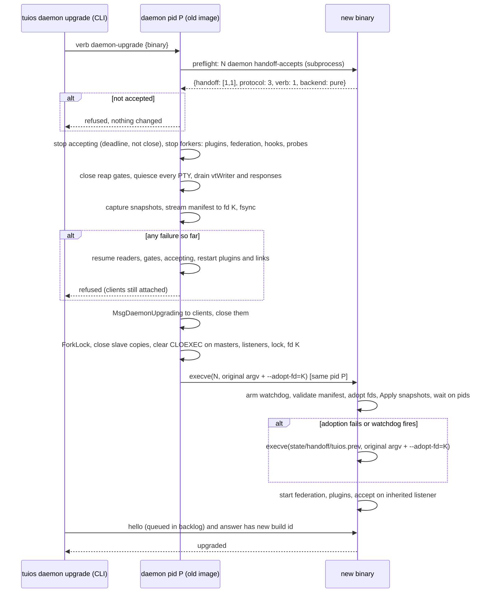

# Live handoff: upgrading the daemon without killing pane processes

Status: draft spec, not implemented. Local issue draft for discussion with the maintainer. Every architectural claim cites `path:line` at commit `b676cc47`.

## TL;DR

- **Goal.** `tuios daemon upgrade` replaces the running daemon with a new binary. Every pane process (shells, editors, agents) keeps running, with the same PID (process identifier), the same TTY (teletype, the pane's terminal device) and the same screen. Today every upgrade path is `kill-server` plus restore from disk, and running programs die (`cmd/tuios/update.go:456-460`, `docs/SESSIONS.md:448-462`).
- **This is already the maintainer's plan.** PR (pull request) #628 is "PR 1 of the daemon live upgrade plan". It made the snapshot carry everything a program can see. It names "the handoff, the fd adoption and the `tuios daemon upgrade` command" as later PRs, and "PR 3 (the handoff format)" as the one that closes the open-cluster gap (commit `b228b387`, `docs/REHYDRATION.md:497-503`, `internal/session/snapshot_complete_wire_test.go:298-304`). This spec fills in PR 2 onward and stays inside that plan.
- **Recommended mechanism: exec in place.** The daemon quiesces, writes a handoff manifest to an inherited, unlinked file, clears close-on-exec on the PTY (pseudo-terminal) masters, the listening sockets and the start lock, then calls `execve` on the new binary. herdr instead spawns a second process and passes the fds (file descriptors) over SCM_RIGHTS (socket control message that carries fds). Exec in place keeps the daemon's PID, so:
  - it stays the **parent** of every pane, and exit detection keeps working through `wait4` with real exit codes;
  - the listening socket never closes, so CLI (command-line interface) and MCP (Model Context Protocol) calls made during the swap wait in the backlog instead of failing;
  - peak memory is roughly one daemon's heap plus one pane's snapshot, not two daemons.
  The cost: there is no old process to roll back to after the exec. A preflight check and a re-exec of the preserved old binary are the mitigation. See section 2.1.
- **Exit detection today** is `exec.Cmd.Wait` in a `monitorExit` goroutine per pane (`internal/session/session.go:4859-4875`). It only works for the process's own children. Exec in place preserves the parent relationship, so the adopted pane waits on `os.FindProcess(pid).Wait()`. A probe for this spec verified this on macOS with Go 1.26: same pid after `execve`, a pre-exec zombie reaped with status 7, a later exit with status 9 (Appendix A). One change is still required in the **old** image: a `Wait` that is already blocked reaps a child that exits mid-handoff and loses its status at exec. So `monitorExit` becomes a two-step wait, a non-reaping peek followed by a reap behind a per-pane gate, and the handoff can close that gate (section 2.2). In a spawn-a-second-daemon design the new daemon is **not** the parent:
  - exit codes would be lost;
  - liveness would come from kqueue `EVFILT_PROC`/`NOTE_EXIT` (macOS) or a pidfd (Linux process file descriptor), plus master EOF (end of file)/EIO (I/O error);
  - orphaned children would be reaped by launchd/init.
- **Peak memory (estimate).** Exec in place: one heap plus a streamed manifest, about 1.5–2.5 MB on disk for 60 panes with visible screens only, about 25–35 MB with 1000 history rows each. Spawn-second-daemon: about 2× heap. A 25-pane mixed load is about 30 MB live heap (PR #735 and #736 bodies). The user reports 50–65 panes at about 26–31 MB heap, a figure not found in the repo.
- **Pause and blackout (estimate).**
  - Pane output is paused for about 0.1–0.4 s with screens only. With 1000 rows per pane on 60 panes it is about 1.8 s serially (0.84 s capture plus an assumed equal apply plus exec), or about 0.5–1.2 s with capture and apply run in parallel.
  - A chatty pane blocks in `write()` once the kernel buffer fills. That buffer is about 1 KB on macOS, measured on this machine (Darwin 27). The pane loses nothing.
  - Clients see a disconnect. PR 5 asks them to reattach. The clients-follow step reattaches them automatically, with a full repaint from the snapshot.
- **Recommended first phase.** Follow the maintainer's PR numbering. The first shippable slice is **PR 2**: a quiesce primitive, a gated two-step exit wait and an adopted-pane constructor. It changes no user-visible behaviour, and an E2E (end-to-end) test drives it through a test-only re-exec. The user-visible feature is PR 2 to PR 5 together:
  - Unix only, opt-in `tuios daemon upgrade`, exec in place, exact manifest version match, local panes only.
  - A fixed history depth of 1000 rows.
  - Refused when hosted panes or an in-process daemon are present.
  - Plugins and federation links stopped and restarted. Clients told to reattach.
  - Pane tokens, pane pids and stream positions carried, so agents keep talking to the daemon.
  - E2E tests prove the same PIDs, an agent that still answers, a real exit status and contiguous output, each with a negative control. Section 5 has the split.

## Context

### What exists today

- **One upgrade path: kill and restore.**
  - `tuios update` leaves the old daemon running and tells the user to `kill-server`: "Panes are restored, but programs running in them are not" (`cmd/tuios/update.go:456-460`).
  - `scripts/install.sh` asks whether to stop the daemon (`scripts/install.sh:216-246`). `just install` passes `--keep-server` (`justfile:96-97`). `just restart` is `kill-server` plus `start-server` (`justfile:131-134`).
  - `tuios hosts sync --restart` runs `kill-server`, `mv`, `start-server` on each host (`cmd/tuios/host_sync_remote.go:179-199`).
- **A version mismatch between client and daemon is expected and warned about.**
  - The daemon outlives an upgrade by design (`internal/session/tuiclient.go:484-496`).
  - The TUI (terminal user interface) shows a toast that says to run `kill-server` (`internal/app/session.go:2320-2336`).
  - An out-of-range wire protocol is refused before attach (`internal/session/daemon_handlers.go:38-43`). The refusal text is at `internal/session/protocol_version.go:83-94`.
- **The snapshot is already handoff-grade.** `snapshot.Capture` carries:
  - the visible grid, plus the normal screen under an active alternate screen;
  - the cursor, the pen and DEC (Digital Equipment Corporation) private modes;
  - the kitty keyboard stack and the modifyOtherKeys level;
  - tab stops, titles and the title stack;
  - OSC (Operating System Command) 4/10/11/12 colours;
  - insert mode (IRM) and newline mode (LNM);
  - the parser's pending input, plus up to 1000 history rows.

  Sources: `docs/REHYDRATION.md:11-25`, `vt/snapshot/state.go:31-194`, `vt/snapshot/capture.go:9-11`. `Apply` is idempotent and works on a fresh emulator (`vt/snapshot/apply.go:12-33`).

### Prior art: herdr `update --handoff`

herdr's flow:

1. The old server pauses the PTY readers and waits for an ack.
2. It spawns the new binary in a hidden import mode.
3. It sends a manifest plus the PTY master fds over SCM_RIGHTS.
4. The new server validates the manifest, rebuilds panes, replays ANSI history for primary-screen panes only, binds the public sockets and reports ready.
5. The old server commits and exits without signalling the pane process groups.

Any failure before commit rolls back. Its limits: Unix only, clients disconnected, agent restore disabled, no cross-version internal-state guarantee. Source: https://herdr.dev/blog/live-updates-without-killing-your-terminal-processes/.

Where tuios can do better than herdr:

| Concern | herdr | tuios proposal | Why tuios can |
|---|---|---|---|
| Alternate-screen panes | Not replayed; best effort until the app redraws | Restored exactly, with the main screen under it | Snapshot carries `MainScreen` and `IsAltScreen` (`vt/snapshot/state.go:51`, `:102`) |
| Modes (bracketed paste, mouse, kitty keys) | Lost until the app re-sends them | Carried | `Modes` from `GetModes()` (`vt/emulator.go:1047-1072`); kitty stack (`vt/snapshot/state.go:69-80`) |
| Exit codes after handoff | n/a (separate process) | Kept | Exec in place keeps the parent (section 2.2) |
| Public socket during swap | Rebound by the new server | Never closed | Listener fd inherited across `execve` |
| Rollback after commit | Old server alive until commit | Weaker: re-exec of the preserved old binary | Inherent cost of exec in place (section 2.1) |

## 1. Design philosophy fit

### 1.1 Where handoff sits in the existing paradigms

| Paradigm | Today | What live handoff does with it |
|---|---|---|
| Daemon/client split | The daemon owns the panes. Clients hold a second emulator per pane and rehydrate from a snapshot plus the stream (`docs/REHYDRATION.md:1-46`) | Handoff is a third rehydration route: daemon to daemon. The new image builds its emulator with the same `Apply` a client uses. The contract (snapshot at `Seq`, then the stream from `Seq`, never overlapping) holds unchanged (`docs/REHYDRATION.md:44-46`, `:202-224`) |
| Snapshot vs stream | Ring of 64 KB plus `outputSeq` per PTY (`internal/session/session.go:2322`, `:4773-4776`) | Carry `outputSeq`, `vtSeq` and the ring bytes so `pane-view`/`stream-pane` resume from their seq without a gap (`internal/session/verb_stream_pane.go:46`, `:457`) |
| Wire version negotiation | Binary protocol 3, min 3 (`internal/session/protocol_version.go:29-34`). JSON verb protocol 1 (`internal/session/verb_protocol.go:44`, `:146`). Clients log as "identified as … (protocol N)" (`internal/session/verb_protocol.go:2804`) | The handoff manifest gets its **own** version range, `HandoffVersion` and `MinHandoffVersion`, independent of both. The old daemon asks the new binary which range it accepts (preflight) before pausing anything |
| "Older daemon" degradation | Capabilities via welcome flags and hello fields (`internal/session/daemon_handlers.go:72-90`, `internal/session/verb_compat.go:59-64`, `:165-167`) | `daemon-upgrade` is a new verb. An older daemon answers `unknown_verb`, and the CLI says "this daemon predates live upgrade; use kill-server" |
| Saved sessions | Session JSON written atomically every 2 s when dirty, and at stop (`internal/session/resurrection.go:20`, `:210-235`, `:339`) | Reuse this as the manifest's structural backbone: workspaces, windows, layout, grants and agent fields are already serialized. Add a `live` section per pane with what restore cannot rebuild |
| `persist_scrollback` | Disk persistence of history across a daemon death. Off means saved files are deleted at start (`internal/session/scrollback_persist.go:104-`, `:186-216`) | Orthogonal. Handoff is memory to memory while the processes live. A separate `handoff_scrollback` knob is in section 3.3 |
| `resume_agents` | `ask`/`auto`/`off` re-launch agents after a restore (`internal/session/agent_resume.go:28-60`, `:142-155`) | Must **not** run for adopted panes, because the agent is still alive. The adopt path is separate from `restoreAllSessions` (`internal/session/daemon_resurrect.go:43-86`) |
| Start lock | Non-blocking `LOCK_EX` flock on `<socket>.lock`, held for the daemon's life (`internal/session/daemon_startlock.go:22-48`, `internal/session/daemon_startlock_unix.go:14-21`, `internal/session/daemon.go:1268-1272`) | Inherited across exec: the flock belongs to the open file description, which survives `execve` when the fd is not CLOEXEC (close-on-exec). No window exists in which a second `start-server` can win the lock |
| `kill-server` is synchronous | SIGTERM, then poll until the socket is unlinked, 10 s limit (`cmd/tuios/session_commands.go:1204-1283`, `cmd/tuios/session_commands_unix.go:19-41`) | `daemon upgrade` is synchronous the same way: it returns when the new image answers hello with the new build id, or with an error after rollback |
| Federation | Links redial with backoff, 1 s to 60 s (`internal/federation/link.go:232-251`, `internal/federation/manager.go:88-93`). Transport is ssh child processes (`internal/federation/dial.go:84`, `:215`) | Stop the links before exec (`internal/session/daemon.go:1563-1575`) and start them after. Peers see a short drop and redial, the same as for a restart |
| Hooks | Daemon events map to hooks (`internal/session/daemon_hooks.go:45-52`). Drained at shutdown (`internal/session/daemon.go:1580-1587`) | Adopted windows must not fire `after-new-window`/`after-close-window`. Drain before exec |
| tmux shim | Control mode re-reads with `refresh()` when the stream ends, exits if that fails, then polls every 2 s (`internal/tmuxcompat/control.go:389-398`, `:455-466`, `:59`) | With the listener inherited, `refresh()` blocks in the backlog instead of failing. The clients-follow step makes it resubscribe |
| herdr shim | The link may be a copy of the binary (`internal/shimlink/copylink.go:17-30`), set at start (`internal/session/daemon.go:1331-1338`) | Refresh the link after adoption, as a start does |
| MCP | Fresh restricted connection per tool call (`internal/mcp/server.go:513-545`) | Works unchanged. A call during the swap waits in the backlog |
| Plugins | Child processes in their own groups (`internal/herdrplugin/runner.go:154-166`), stopped at shutdown (`internal/session/plugin_host.go:159-162`) | Stop before exec, start after, the same as a restart |

### 1.2 Where the command belongs

- **`tuios daemon upgrade [--binary PATH]`**, the name the maintainer already chose in PR #628. Default binary: the `tuios` executable that ran the command. This is not `kill-server --handoff`: kill-server's contract is "the daemon ends", and an upgrade's is "the daemon continues as another binary".
- **Integration points, later phases:**
  - `scripts/install.sh` gains a third answer at its existing prompt, "upgrade live (experimental)", next to keep and kill (`scripts/install.sh:216-246`).
  - `tuios update` prints `tuios daemon upgrade` before the kill-server advice (`cmd/tuios/update.go:456-460`).
  - `just install-live`.
  - `tuios hosts sync --restart --live` runs `daemon upgrade` on the remote instead of kill/mv/start (`cmd/tuios/host_sync_remote.go:179-199`).
- **Opt-in vs default.** Opt-in while it is experimental. It becomes the default answer in install.sh only after the cross-version E2E (versions-span step) has run green across at least two release boundaries.

### 1.3 How it reads to a user

```
$ tuios daemon upgrade
Checking /opt/homebrew/bin/tuios (v0.10.1) accepts this daemon's state (handoff v1)... ok
Pausing 58 panes, saving their screens (1.1 MB)...
Starting v0.10.1 in place (pid 41213 kept)...
Upgraded in 0.31 s. 58 panes and their programs kept. 2 attached clients were asked to reattach.
```

What an attached client sees:
- PR 5: "The daemon was upgraded to v0.10.1. Your programs are still running. Run `tuios attach work` to continue."
- Clients-follow step: a short "upgrading…" frame, then the same screen.

Refusal is explicit and changes nothing: "v0.11.0 cannot read this daemon's state (handoff v1, it needs v2+). Nothing was changed. Use `tuios kill-server` to restart, which ends running programs."

### 1.4 How an E2E proves it (testing rule)

AGENTS.md prefers E2E tests that produce a repeatable artifact, and requires each one to fail on a build with the fix removed (`e2e/tui/NEGATIVE_CONTROLS.md:26-53`). The harness already provides the pieces:
- isolated XDG (XDG Base Directory) roots per test (`e2e/tui/harness_test.go:262-322`);
- `tuiosCLI` (`e2e/tui/harness_test.go:835-848`);
- `pane-agent` returning `shell_pid` and `pid` (`internal/session/verb_pane.go:217-239`);
- `pid-$$` markers (`e2e/tui/move_window_session_test.go:96-102`);
- a baseline-binary pattern for mixed versions (`e2e/tui/verb_hello_term_test.go:282-300`).

The core test, `TestDaemonUpgradeKeepsPaneProcesses`:

1. Start a daemon. Open three panes:
   - (a) `sh -c 'echo pid-$$; i=0; while :; do i=$((i+1)); echo tick-$i; sleep 0.01; done'`, a contiguous counter;
   - (b) a fake agent loop, `while read l; do echo "got-$l"; tuios agent-state working; done`, which uses its `TUIOS_PANE_TOKEN`;
   - (c) an alternate-screen program that enables bracketed paste and SGR (Select Graphic Rendition) mouse mode and echoes its input through `cat -v`.
2. Record each pane's `shell_pid` via `pane-agent`.
3. Copy the binary to a second path, and run `tuios daemon upgrade --binary <copy>`.
4. Assert:
   - the daemon pid is unchanged, but `/proc/<pid>/exe` (Linux) or `ps -o comm` reports the copy's path;
   - the same `shell_pid` for every pane;
   - pane (a)'s ticks are contiguous across the upgrade, with no gap or duplicate in `daemonScrollback`;
   - pane (b) answers `got-x` to sent input, and its token-authenticated verb succeeds;
   - pane (c) still reports the alternate screen, and a paste arrives wrapped in `^[[200~ … ^[[201~`;
   - then `exit 7` in pane (b) gives a window-exit event with status 7.
5. Write an artifact: JSON with pids before and after, tick ranges, pause milliseconds and manifest bytes.

Negative controls, each cutting a call site:

| Control | Expected failure |
|---|---|
| Do not clear CLOEXEC on the masters | Pids differ, because panes hang up |
| Skip the reader quiesce | Tick gap or duplicate |
| Do not carry the pane-token key | A token-only caller is refused. The kernel's peer pid wins whenever it places the caller in a pane, and the token is checked only otherwise (`internal/session/conn_scope.go:426-445`). So this control needs a caller **outside** the pane's process tree: a `setsid` daemonized helper started from pane (b), or a `paneOnly` connection. Pane (b)'s own verb would pass without the key and catch nothing |
| Do not rebuild the pid-to-pane map from the carried pids | Pane (b)'s in-tree verb is not placed in its pane |
| Leave `monitorExit` as a plain `cmd.Wait` (no gate) | A pane that exits inside the quiesce window loses its status |
| Drop `Modes` from the applied state | No paste brackets |
| Adopted pane does not wait on its pid | Exit event never arrives |

## 2. Architectural changes and their implications

### 2.1 Mechanism: exec in place vs a second process

| | Exec in place (recommended) | Second process plus SCM_RIGHTS (herdr) |
|---|---|---|
| Parent of pane processes | Unchanged, because the PID is kept | Old daemon. After it exits, the panes reparent to launchd/init, or to a Linux subreaper ancestor |
| Exit code after handoff | Real, via `wait4` | Lost. Only liveness is available |
| Listening sockets | Inherited and never closed. Callers queue in the backlog | Passed or rebound. There is a window where dials fail |
| Start lock, pid file | Inherited flock, same pid | Must pass the flock fd, rewrite the pid file, and keep both locks consistent |
| Peak memory | About 1× heap plus one pane's snapshot buffer | About 2× heap plus the manifest in flight |
| Exactly one reader per PTY | Trivial after exec. Before exec, the quiesce must not lose an in-flight chunk | Needs pause, ack and handover. Two processes hold the master until commit |
| Rollback | Before exec: free (nothing changed). After exec: re-exec the preserved old binary with the same manifest. If both fail, panes hang up as in a crash | Old process alive until commit. True rollback |
| Embedded daemon (in-process in `tuios-web`/SSH, `internal/session/autostart.go:38-66`) | Must refuse: exec would replace the web or SSH server | Possible in principle, still messy |
| Go specifics | Go opens every fd CLOEXEC. Clear it per fd with `unix.FcntlInt(fd, F_SETFD, 0)` before `syscall.Exec`, under `syscall.ForkLock` (below). `syscall.Exec` is supported from a multithreaded Go process. Verified by the Appendix A probe | `unix.UnixRights`/`ParseUnixRights`, none in the repo today |

Recommendation: exec in place. The maintainer's own wording in PR #628, "restores each pane's emulator from its snapshot in a new daemon image", fits it. The rollback weakness is bounded, but not removed, by these:
- **Preflight.** Run `<new> daemon handoff-accepts`, which prints its accepted manifest version range, protocol versions and backend (pure or ghostty), and exits. Do this before any pause. A binary that cannot run, or does not accept the version, is refused with nothing changed. It also proves the new binary starts at all: package init and flag parsing run here, the same code that would run first after `execve`.
- **Keep the old binary from daemon start, not at upgrade time.** By the time someone runs `daemon upgrade`, the installer has already put the new binary in the old one's place:
  - `scripts/install.sh` renames over the path (`scripts/install.sh:171-180`);
  - Homebrew re-points its symlink, and `brew cleanup` may delete the old Cellar copy.

  An inode with no name left cannot be hardlinked, and macOS has neither `/proc/self/exe` nor `fexecve`. So at daemon **start**, record the executable's device and inode and hardlink it, or copy it when the hardlink crosses filesystems, to `<state>/handoff/tuios.prev`. That costs about 35–40 MB of disk only when it falls back to a copy (binary-size ceiling, `docs/perf.md:2503`). At upgrade time, check that `tuios.prev` still matches the recorded inode or content hash, and refuse otherwise. On Linux `/proc/self/exe` is a further source.
- **Fallback.** The new image runs adoption inside a recover boundary. On an adoption error it seeks the manifest fd back to 0 and re-execs `tuios.prev` with the original argv and env. The old image validates its own manifest version, so this path is the same code it ran before. A recover boundary covers only its own goroutine, so adoption must not start other goroutines until it has validated and applied everything.
- **Watchdog.** The CLI that issued the upgrade holds no fds, so it cannot rescue the panes. The new image arms a timer before adoption, and re-execs `tuios.prev` if adoption has not reached "accepting" within N seconds, which covers a hang or deadlock.
- **No fork while fds are exposed.** The daemon forks concurrently: hooks, plugin commands, federation ssh, git and agent probes. A fork between clearing CLOEXEC and `execve` would leak the masters into a long-lived child, so the pane never hangs up, and would leak the start-lock fd, so `LOCK_EX` stays held after the daemon dies and every later `start-server` fails with `ErrDaemonStarting` (`internal/session/daemon_startlock_unix.go:14-21`). So:
  1. stop every forker first;
  2. hold `syscall.ForkLock` for writing from the first `F_SETFD` until `syscall.Exec`;
  3. never return from that critical section except through exec or a full CLOEXEC re-set.
- **Startup side effects in the adopt path.** Normal start runs sweeps that are wrong for adopted panes. The order is at `internal/session/daemon.go:1350-1413`:
  - `CleanResurrectionDir`;
  - `stash.sweep` (`RemoveAll`, `internal/session/stash.go:506-519`);
  - `pastes.sweep`;
  - `startSSHAgent`/`startDisplayFollow`, which sweep the links that panes' `SSH_AUTH_SOCK` and `WAYLAND_DISPLAY` point at;
  - `dropHistoryWhenOff`;
  - `checkGrantsSinceLastRun`, which notifies again;
  - `applyResumeOffers`.

  The adopt path must skip or guard each one, in the new image and in the fallback alike, or a pane's ssh agent link vanishes under a running agent.
- **Same argv and env.** The new image is exec'd with the daemon's original flags (socket, server name, debug, config) and its original environment. For example `startSSHAgent` reads `SSH_AUTH_SOCK` from the env (`internal/session/ssh_agent_follow.go:204`).

The residual risk is a new image that dies hard before its fallback: a runtime fatal error such as a concurrent map write or out of memory, or `SIGKILL`. Every pane then hangs up, as in today's daemon crash. Section 6 lists it, and the two-process alternative is open question 1.

### 2.2 Exit detection today and after adoption

- **Today.**
  - SysProcAttr is `Setsid: true, Setctty: true` (`internal/ptyspawn/spawn_unix.go:15-20`), so each pane leads its own session with the PTY as its controlling terminal.
  - `monitorExit` blocks in `p.cmd.Wait()` and reads `ExitCode()` and the signal (`internal/session/session.go:4859-4875`, started at `:2473`).
  - `noteExit` sets the status, drops transient OSC 7501 records, calls `onExit` (which removes grants and sends `MsgPTYClosed`) and emits `EventWindowExit` (`internal/session/session.go:4886-4914`, `:2197-2202`, `internal/session/daemon_stream.go:216-254`).
  - A local pane's read error does **not** call `noteExit`. Only remote panes do (`internal/session/session.go:4636-4646`).
  - No SIGCHLD handling, subreaper, pidfd or process kqueue exists in the repo. kqueue is used only in `internal/dirwatch/dirwatch_kqueue.go:32`.
- **Who reads the status.**
  - `ExitStatus()`/`ExitSignal()` (`internal/session/session.go:4602-4608`);
  - `internal/session/verb_handlers.go:545`, `internal/session/popup_wait.go:148`, `internal/session/verb_stream_pane.go:391-392`, `internal/session/verb_fan_compare.go:518`;
  - agent resume (`internal/session/agent_resume.go:211`, `:282`).

  A lost exit code changes user-visible results: `popup` waits and fan compares.
- **After adoption with exec in place.** The adopted `PTY` has `cmd == nil` but carries `pid`. A new `monitorAdoptedExit` calls `os.FindProcess(pid)` then `Process.Wait()`. On Unix `FindProcess` always succeeds, and `Wait` uses `wait4`/`waitid`, which works because the process is still our child. Exit code and signal are identical to today. Idle cost is zero: one blocked goroutine per pane, the same as now.
- **A child that exits during the handoff window: `monitorExit` must change first.** A `Wait` that is already blocked cannot be told to stop waiting. Go parks it in `waitid(WEXITED|WNOWAIT)`, or in `waitid(P_PIDFD)` with pidfds on Linux, and then reaps. So a child that exits after its record is written but before `execve` would be reaped by the old image. That would also run `noteExit`, `onExit` (grants removed) and `MsgPTYClosed`, and the status would vanish at exec. The new image's `Wait` would then see ECHILD, or, after pid reuse, wait on an unrelated process. Fix:
  1. `monitorExit` waits in two steps: a non-reaping peek (`waitid(..., WEXITED|WNOWAIT)` on the pid, or poll on a pidfd);
  2. then a reap taken under a per-pane `reapGate`.

  The quiesce closes every `reapGate` before writing records. A child that the peek saw exit, but that was not reaped, stays a zombie of our pid, and the new image reaps it with its real status (verified, Appendix A). A child already reaped before the gate closed is written as `exited, status N` and adopted as exited. The new image treats ECHILD as "exited, status unknown", never as a live pane. Because the gate lives in the **old** image, it must ship one release before any upgrade can rely on it: PR 2 below.
- **If the second-process design is chosen instead.**
  - Liveness: macOS `EVFILT_PROC` with `NOTE_EXIT` works on any process the user may signal. Linux `pidfd_open` plus poll does the same.
  - Exit status: `waitid(P_PIDFD)` works only for children. ⚠️ Whether macOS `NOTE_EXITSTATUS` reports status for a non-child is unverified.
  - Master EOF/EIO also signals the end once no process holds the slave. This requires the new daemon not to hold a slave copy. xpty keeps the slave open in the parent (`$GOMODCACHE/github.com/charmbracelet/x/xpty@v0.1.4/pty.go:11-13`, `:39-50`, `:90-104`), and `releaseSlave` closes it only for hosted panes (`internal/session/hosted_pane.go:221-247`).
  - Zombies: an exited pane stays a zombie of the old daemon until that daemon exits. Then launchd/init (or a Linux `PR_SET_CHILD_SUBREAPER` ancestor such as `systemd --user`) reaps it.
  - Result: the exit code would be reported as unknown, which is a visible regression.

### 2.3 What the daemon owns, and what happens to each

Per pane (the `PTY` struct, `internal/session/session.go:824-1102`):

| State | Where | Handoff action |
|---|---|---|
| PTY master fd | `pty paneIO`, narrowed to `io.ReadWriteCloser` plus `Resize` with no `Fd()` (`internal/session/session.go:818-821`, `:845`); concrete `*xpty.UnixPty` with `master, slave *os.File` (`xpty@v0.1.4/pty.go:11-13`, `Fd()` at `:53-55`) | Type-assert to reach the master. Clear CLOEXEC. Record the fd number in the manifest. The new image wraps it with `os.NewFile` in an adopted `paneIO` |
| PTY slave fd (daemon's copy) | Kept open by xpty for local panes (`internal/ptyspawn/spawn.go:84-121`, `xpty@v0.1.4/pty.go:90-104`) | **Close it before exec. Do not carry it.** Holding it prevents master EOF and is not needed for I/O or resize. Resize goes through the master (`internal/ptyspawn/winsize.go:28`) |
| Process | `cmd *exec.Cmd` (`internal/session/session.go:846`) | Carry the pid and pgid. Adopt as in section 2.2 |
| Extra fds passed to the child | `sp.extraFiles` (`internal/session/session.go:2141`, `:2163`, `:2262-2264`) | The daemon's copies close at exec. The child keeps its own. ⚠️ Callers not traced. Check that none needs the daemon's copy after spawn |
| Reader pipeline | One `readOutput` goroutine with a 16 KB buffer, then the ring, then broadcast, then `vtWriteChan` (256, blocking) to `vtWriter` and the emulator (`internal/session/session.go:4610-4717`, `:4622`, `:2325`, `:4734-4769`) | Quiesce: stop reading, then drain `vtWriter` to idle, then capture. See section 2.4 |
| Terminal responses | `forwardTerminalResponses` copies the emulator's replies (DA, CPR, OSC 10/11 queries, kitty key queries) from a pipe into the master with a 4 KB buffer (`internal/session/session.go:4921-4942`, started at `:2469`) | Drain to empty after `vtWriter` is idle and before capture. Otherwise a shell or editor waiting for a CPR (Cursor Position Report) hangs forever |
| Emulator state | `terminal` | `snapshot.Capture` into the manifest. `Apply` in the new image. Scrollback depth per section 3.3 |
| Stream position | `outputSeq`, `outputBuffer` (64 KB), `resizeMarks`, `vtSeq`, `vtResizes` (`internal/session/session.go:882-890`, `:1007-1010`) | Carry all of them, so resumers (`pane-view`, `stream-pane`) continue from their seq |
| Cwd and place | `place`, from OSC 7 (`internal/session/session.go:1087-1089`); `WindowState.Cwd`, `StartDir`, `CwdHost` (`:122-132`) | Carry. Not in the snapshot |
| Program title | `title` (`internal/session/session.go:1086`) | Carry |
| OSC 133 marks, shell tracking | `marks`, `shell` (`internal/session/session.go:1092`, `:1098`) | Carry. Needed for scrollback jumps and `after-command-finished` |
| progstatus (OSC 7501) | `progStatus progstatus.Store` (`internal/session/session.go:1072`), mirrored to `WindowState.ProgramStatus` (`:224`) | Carry the store, not only the mirror |
| Agent state | `WindowState.Agent*` (`internal/session/session.go:149-218`), detection timers and notification (`:1023-1066`) | Carry the fields. Restart the timers fresh. Suppress `after-agent-state` for the unchanged state |
| Subscribers, leases, foreground pgid, cell pixel size | `internal/session/session.go:893-993` | Subscribers drop with their clients. Leases: carry or expire, an open question. Pgid and pixel size are re-read |
| Grants | `WindowState.Grants` in the session state (`internal/session/session.go:315-322`), `grants/applied.json` (`internal/session/grants_record.go:37-40`) | Carried by the session state. Do not run the grant-removal `onExit` wrapper during quiesce |
| Raw log | `rawLog`, only with `TUIOS_PTY_LOG` (`internal/session/session.go:847-849`) | Reopen in append mode |

Per daemon:

| State | Where | Handoff action |
|---|---|---|
| Main, link and herdr sockets | `internal/session/daemon.go:1288`, `:1315`, `:1319`, `:1323`; accept goroutines at `:1415-1428`; main socket already `SetUnlinkOnClose(false)` (`:1300-1302`) | Stop accepting with `SetDeadline` on the listener to unblock `Accept`. Never `Close` it. Clear CLOEXEC, carry the fd numbers. The new image wraps them with `net.FileListener`. Check that the link and herdr listeners also do not unlink on close. Queued connections survive (verified, Appendix A). The backlog is `somaxconn`: 128 on macOS, 4096 on recent Linux |
| Accepted client connections | | Send `MsgDaemonUpgrading` (new message), then close. Section 2.6 |
| Start lock, pid file | `internal/session/daemon_startlock.go:22-48`; `internal/session/daemon.go:2348-2351` | Inherit the lock fd. The pid file is unchanged, since the pid is the same |
| Pane-token HMAC (hash-based message authentication code) key | Random per start, never written (`internal/session/pane_token.go:18-42`) | **Must carry.** Otherwise every agent's `TUIOS_PANE_TOKEN` stops verifying, and on platforms without peer pid that is the only identity (`internal/session/pane_token.go:12-22`). Secret: manifest file mode 0600, unlinked before exec |
| Peer-pid to pane identity | The kernel's peer pid is walked up to a pane's shell, and that answer wins (`internal/session/conn_scope.go:426-445`, `internal/session/pane_token.go:12-15`) | The new image must know each adopted pane's shell pid before it accepts the first connection, or in-tree agent calls are placed in no pane |
| Event hub | Memory ring of 4096 events plus a random boot id (`internal/session/daemon_events.go:14-25`, `:115-118`, `:421-434`) | Carry the boot id, next seq and ring. Otherwise subscribers get `GapBootChanged` (`internal/session/daemon_events.go:127`) |
| Agent mailbox | Memory only, deliberately not durable (`internal/session/verb_mailbox.go:13-30`) | Carry. It is small, and agents mid-conversation are the point of this feature |
| Inbox, outbox, review notes, transfers | JSON files (`internal/session/attention.go:358-362`, `internal/session/host_outbox.go:167-170`, `internal/session/review_notes.go:65`, `internal/session/transfer_journal.go:134`) | Flush before exec (shutdown already does: `internal/session/daemon.go:1523-1530`). Reload as at start |
| Federation links | ssh child processes (`internal/federation/dial.go:215`, killed at `:251`) | Stop before exec, start after. Peers redial |
| Hosted panes (run here for another machine) | PTYs plus children (`internal/session/hosted_pane.go:175`, `:380`) | PR 4 and PR 5: refuse unless `--force`, which closes them as kill-server does. Completeness step: adopt like local panes |
| Plugins | Child processes (`internal/herdrplugin/runner.go:154-166`) | Stop, then start |
| Hooks | `sh -c` children run synchronously (`internal/hooks/hooks.go:252`, `:283`) | Drain before exec, as shutdown does (`internal/session/daemon.go:1580-1587`) |
| ssh-follow, ssh agent and display links, transcript watcher | `internal/session/ssh_follow.go:418`; `internal/session/daemon.go:1361-1362`, `:912-913` | Stop, then start. The fsnotify fd closes at exec |
| cleanupLoop, stallMonitor, agentMonitor, memtrim | `internal/session/daemon.go:2090`, `:2301`, `:2202`; `internal/memtrim/memtrim.go:51-82` | Gone at exec, started fresh. No state worth carrying |
| pprof | Optional listener (`cmd/tuios/main.go:631-633`) | Rebind if the flag is set |
| SSH server, MCP, web | Not daemon-owned: they are client processes, `tuios mcp` and `tuios-web` | Unaffected, except when they host an embedded daemon. Refuse (section 2.1) |

### 2.4 The exactly-one-reader invariant and the quiesce

- After exec, only the new image exists, so two readers are impossible. The risk is **before** exec: a chunk that `readOutput` has read from the kernel but not yet appended to the ring is lost at exec.
- There is no "stop reading but keep the fd" mechanism today. The only stop is ctx cancel plus closing the PTY (`internal/session/session.go:4624-4627`, `:4545-4549`). `holdForSlowSubscribers` runs before each read (`internal/session/session.go:4633`, `internal/session/graphics_backpressure.go:102`).
- Required primitive: `PTY.Quiesce()` returns only when all of these hold:
  1. the reader is guaranteed not to consume another byte;
  2. every consumed byte is in the ring and the emulator;
  3. `vtWriter` is **idle**: an ack has come back through `vtWriteChan`.

  `vtSeq == outputSeq` alone is not enough. `vtWriter` sets `vtSeq` and then, outside `terminalMu`, runs `noteFocusReporting` and `flushProgramStatus` (`internal/session/session.go:4760-4768`). A capture could then see equal seqs with progstatus and focus state not yet updated.
  4. the terminal-response pipe is drained (section 2.3).
- Candidate mechanisms:
  1. **Read deadline: Linux only.** creack/pty opens `/dev/ptmx` with `os.OpenFile` on Linux, so the master is in Go's poller there. On darwin it uses `syscall.Open(..., O_CLOEXEC)` plus `os.NewFile` (`$GOMODCACHE/github.com/creack/pty@v1.1.24/pty_darwin.go:13-18`). That fd is blocking, so `SetReadDeadline` fails with `ErrNoDeadline`. Separately, `UnixPty.Fd()` (`xpty@v0.1.4/pty.go:53-55`) calls `os.File.Fd()`, which switches the fd to blocking mode and disables deadlines everywhere. Reach the fd through `UnixPty.Control` (SyscallConn) instead.
  2. **Read gate: portable, recommended.** The reader takes a per-pane `readMu` around "check the quiesce flag, then read, then process", and blocks in a readiness wait outside the lock. The quiesce takes `readMu`, sets the flag and wakes the waiter through a self-pipe. ⚠️ macOS `poll()` has historically not supported character devices; `select()` does. Verify in the PR 2 E2E.
- Bytes in the kernel buffer at exec are not lost. They are read by the new image.

### 2.5 The handoff protocol



- **Manifest format.** A header `{magic, HandoffVersion, writer build, backend, pane count}` followed by framed records:
  - the session state JSON (the existing resurrection writer);
  - one record per pane with the `live` section and the packed `TerminalState` (`vt/snapshot/pack.go:38-42`);
  - the daemon record: token key, pane shell pids, event hub, mailbox;
  - each emulator's **open grapheme cluster**. PR #628 assigns this to the handoff format (commit `b228b387`, `docs/REHYDRATION.md:497-503`). It is not optional here: a quiesce can split a cluster between two reads, and an emulator rebuilt without it would corrupt the daemon's own screen permanently, not only a client's.

  Framed records allow a streamed write and read: no whole-manifest buffer and no 16 MiB frame cap (`internal/session/wire_bounds.go:98`).
- **Versioning.** `HandoffVersion` is an integer. The reader accepts `[MinHandoffVersion, HandoffVersion]`. `TerminalState` itself has no version field; its fields are only ever added (`vt/snapshot/doc.go:13-15`). Gob tolerates added fields, so a minor build difference reads fine and the integer only moves for breaking changes. PR 3 to PR 5 require an exact match.
- **Where the manifest lives.** A file created 0600 under `<state>/handoff/` and unlinked immediately after open, so only the inherited fd names it. On Linux, `memfd_create` keeps it off disk. A pipe is not enough: the writer and reader are the same process across an exec, so the pipe buffer would deadlock.
- **Commit point.** The `execve` itself.
  - Every fallible step (preflight, quiesce, manifest write and fsync) comes **before** clients are told and closed. A failure there resumes the readers, reopens the gates and accepting, restarts plugins and links, and returns an error with clients still attached.
  - Between closing clients and `execve`, only infallible steps remain, apart from `execve` itself. `ETXTBSY` and `ENOEXEC` are ruled out by the preflight having executed the same path. A failing `execve` returns, and the daemon re-sets CLOEXEC and resumes. Clients are dropped and must reattach.
  - `--force` closes hosted panes before the commit point. That change is not undone by a refusal, which the command says.
  - After `execve`, the fallback is the re-exec of section 2.1.

### 2.6 Attached clients

- **Today no client reconnects to the local daemon.** The TUI quits with `ExitDaemonLost` (`internal/app/daemon_wiring.go:150-155`, `internal/app/update.go:2454-2457`, message at `cmd/tuios/session_commands.go:639-644`). SSH and web TUIs quit too (`internal/app/daemon_exit.go:15-33`, `:114-117`).
- **Reconnect does exist for other hosts:** 1 s first delay, 15 s cap, 3-minute budget (`internal/app/host_reconnect.go:44-70`), and for `pane-view` (`cmd/tuios/pane_view_command.go:188-204`, `:404-417`).
- **PR 5.** Add `MsgDaemonUpgrading{version}` before close. A new client prints "The daemon was upgraded to X. Your programs are still running. `tuios attach <s>`". An old client shows its existing daemon-lost text, which is acceptable.
- **Clients-follow step.** Reattach automatically. The running TUI client is the **old** binary. If the new daemon's protocol range excludes it (`internal/session/protocol_version.go:60-63`), it cannot reattach. So the client re-execs the new binary on disk as `tuios attach <session>` in the same terminal. This mirrors the daemon and keeps "one binary version per box after an upgrade". When the protocol is still compatible, it reattaches in-process using the host-reconnect loop with `AttachPayload.Reconnect` (`internal/session/tuiclient.go:68-70`), so it does not fire attach hooks.
- **Keystrokes typed during the blackout** go nowhere in PR 5, because the client has quit. In the clients-follow step the client buffers input while reconnecting and sends it after the reattach, bounded.

### 2.7 Platforms, backends, remote hosts

- **Windows/ConPTY.** Unsupported. ConPTY is a pseudoconsole handle plus pipe handles, not fds (`conpty@v0.2.0/conpty_windows.go:19-26`), and kill-server uses a named stop event (`cmd/tuios/session_commands_windows.go:37-60`). `daemon upgrade` answers "live upgrade is not supported on Windows; `tuios kill-server` restarts and ends running programs". A future port would need `DuplicateHandle` of the HPCON (pseudoconsole handle) and pipes into a spawned process. There is no code for it.
- **ghostty backend (`-tags ghostty`).** Capture and apply work, and the in-process tests cover pure to ghostty, ghostty to pure and ghostty to ghostty (`internal/session/ghostty_wire_test.go:250-341`). A release binary carries one backend (`docs/ghostty-vt.md:15-20`). The preflight reports the new backend, and a backend change is allowed but logged.
  - Caveat: ghostty history capture is slow, more than 250 ms per 5000 rows at 200 columns (`internal/session/scrollback_persist.go:52-57`), so cap the history depth on ghostty.
  - Caveat: `SetScrollbackMaxLines` after construction is a no-op on ghostty (`docs/ghostty-vt.md:158-159`), so the new image must build each emulator with the carried limit.
  - ⚠️ A binary-to-binary pure to ghostty handoff is untested.
- **Remote hosts.** `hosts sync --restart` restarts only daemons whose version differs (`cmd/tuios/host_sync.go:32-41`, `:715-759`). The versions-span step adds `--live`, which runs `tuios daemon upgrade --binary <new>` remotely. A remote that refuses falls back to the current restart only with `--restart`.

## 3. Memory considerations

### 3.1 Baseline numbers

| Measure | Value | Source |
|---|---|---|
| 25-pane mixed load, live heap | 42.3 MB, then **29.6 MB** after #735 and #736 | PR #735 and #736 bodies |
| User-reported 50–65 panes | ~26–31 MB heap | User report. ⚠️ Not in the repo |
| Daemon RSS (resident set size) after 49 of 50 panes close | 41–49 MB after memtrim | `docs/perf.md:2894` |
| Packed snapshot, 207x55 screen | 22.7 KB (palette), 42.1 KB (truecolor), 170.9 KB (worst case) | `docs/perf.md:680-690` |
| Packed snapshot, screen plus 1000 rows | 417 KB (palette), 588 KB (truecolor) | `docs/perf.md:680-690` |
| Capture, 1000 rows | 14 ms, 3.2 MB allocated, lock held 0.9 ms | `docs/perf.md:2832-2833` |
| Scrollback ring default | 10,000 lines, stored encoded (a plain line costs its length in bytes) | `vt/scrollback.go:17`, `:31-39` |
| Full 10k x 207 ring, decoded | 251 MB of cells. Never decode it whole | `docs/perf.md:2791-2793` |

### 3.2 Peak during handoff

- **Exec in place.**
  - Before exec, the peak is the live heap plus the capture buffers in flight, because records stream to the manifest fd. A 1000-row capture allocates 3.2 MB transiently (`docs/perf.md:2832-2833`). Captured serially, that is one buffer. In parallel it is up to GOMAXPROCS × 3.2 MB, about 26 MB on 8 cores. That trade between pause and memory is set by a worker count.
  - At exec the old image's memory is released wholesale.
  - After exec, the new image rebuilds emulators from the manifest. It reads one record at a time, so it peaks at about the steady-state heap plus one record.
  - The manifest itself sits in the page cache (macOS, an unlinked file) or in a memfd (Linux). **A memfd is RAM** (random-access memory) until the new image closes it, so on Linux the true peak is the heap plus the whole manifest. Close or truncate it as soon as adoption has read it. Estimated size for 60 panes:
    - screens only: 60 × 23–42 KB ≈ **1.4–2.5 MB**;
    - with 1000 rows: 60 × 0.42–0.59 MB ≈ **25–35 MB**;
    - with full 10k rings, scaled from the measured 1000-row figures: 60 × 4.2–5.9 MB ≈ **250–350 MB** worst case. Hence section 3.3.
- **Second process.** Two full daemons, about 2 × 30 MB live heap (more RSS), plus the manifest in flight on the socket.
- **After the handoff.** The new image has no alternate-screen or reflow scratch until it is used again, which is better than steady state. #735 and #736 release those every 30 s (`vt/reflow.go:65`, `vt/emulator.go:874`, `internal/session/daemon.go:2079-2120`). #762 (client side) is still open. Call `memtrim.Request()` once adoption completes; it only trims when the heap holds at least 32 MB beyond live data (`internal/memtrim/memtrim.go:23-84`).

### 3.3 Scrollback: transfer it or not

- `persist_scrollback` governs history across a daemon **death**: on by default, 1000 lines and 2048 KB (`internal/config/userconfig.go:231-244`). When the processes survive, as in a handoff, the history is still live context for a running program, often an agent's earlier output.
- The user runs `persist_scrollback = false` and wants no history restored on restart, only agents. Handoff is not a restart. Still, the choice is offered rather than imposed.
- First slice: no knob. Carry a fixed 1000 rows, the depth every client already gets (`vt/snapshot/capture.go:9-11`). The knob comes in the completeness phase, so the smallest slice adds no config surface. Proposed knob `handoff_scrollback`:

| Value | Carries | Cost for 60 panes | When |
|---|---|---|---|
| `"ring"` | The whole encoded ring via `CopyScrollback`, a byte or so per cell, no decode (`docs/perf.md:2797-2810`) | Up to ~100+ MB of manifest when every ring is full. Capture time grows | Fidelity first |
| `"snapshot"` (**proposed default**) | 1000 rows, the same depth a client gets on attach (`vt/snapshot/capture.go:9-11`) | ~25–35 MB, ~0.84 s capture serially | Matches what a client can already scroll without a round trip |
| `"none"` | The screen (and the main screen under the alternate one) | ~2.5 MB, ~0.1 s | Smallest pause. For users who want no history, like this user |

- Open question: should `persist_scrollback = false` imply `handoff_scrollback = "none"` when the knob is unset? This spec proposes **no**: they answer different questions.

## 4. Performance and visual considerations

### 4.1 Pause and what a chatty process experiences

- **Kernel buffer.** On macOS (Darwin 27, measured here with a Python `pty.openpty` and non-blocking writes), the slave-to-master direction buffers about **1,024 bytes** before `EAGAIN`, in raw and cooked mode. A blocking writer of 200,000 bytes held for 1 s completed with no loss once the master was read. So a chatty pane **blocks in `write()`**: it does not lose data and does not error.
  - ⚠️ Linux is not measured here. n_tty and the flip buffer are expected to hold several KB to tens of KB. The PR 4 E2E artifact records the number.
- **Effect on agents.** An agent streaming tokens blocks on stdout for the pause. Its network sockets are unaffected. A pause under one second is invisible to an LLM (large language model) API stream. An agent's own `tuios` CLI calls during the pause queue in the inherited listener's backlog. That backlog is bounded by `somaxconn`, 128 by default on macOS. ⚠️ Not verified under load.
- **Pause estimate.** Quiesce, capture, write, exec, Go runtime init, config load and apply:
  - Capture is about 1–2 ms per pane screen-only, by extrapolation, and 14 ms with 1000 rows (`docs/perf.md:2832-2833`). Run it in parallel across panes, up to GOMAXPROCS.
  - Apply is assumed similar to capture.
  - Exec and init are unmeasured; estimated 50–150 ms.
  - Total, 60 panes:
    - `"none"`: **~0.1–0.4 s**;
    - `"snapshot"`: **~1.8 s** serially (0.84 s capture + ~0.84 s apply + exec), or **~0.5–1.2 s** with capture and apply both parallel.

    The PR 4 E2E artifact records the real figure.

### 4.2 Client-visible blackout and redraw

- PR 5: the blackout ends when the user reattaches. Clients-follow step: the pause plus the first reconnect attempt (1 s first delay in `internal/app/host_reconnect.go:44-65`; a local upgrade should retry within 100 ms).
- The redraw is a full repaint. The client primes each pane from a snapshot, as on attach (`primePaneFromDaemon`, `docs/REHYDRATION.md:154`, `:587`). Nothing new is needed. The client's emulator is rebuilt from the new daemon's.

### 4.3 Fidelity that keeps applications working

| Must survive | Carried? | Source |
|---|---|---|
| Alternate screen plus the main screen under it | Yes | `vt/snapshot/state.go:51`, `:102` |
| Bracketed paste, mouse modes, DECCKM (cursor keys mode), autowrap, origin | Yes, through `GetModes()`. Synchronized output (2026) is deliberately excluded | `vt/emulator.go:1047-1072` |
| Kitty keyboard flags (both screens), modifyOtherKeys | Yes | `vt/snapshot/state.go:69-80`, `:91-92` |
| Cursor shape, DECSC (save cursor) per screen, scroll region, charsets | Yes | `vt/snapshot/state.go:56-68`, `:157-158` |
| Parser mid-sequence | Yes | `vt/snapshot/state.go:193` |
| Open grapheme cluster | **Not today.** A known gap, and the handoff format must close it (PR 3), because a quiesce can split a cluster | `internal/session/snapshot_complete_wire_test.go:298-304` |
| Kitty and sixel image pixels | **No.** Only the id bookkeeping is carried | `vt/snapshot/state.go:85`, `vt/kitty_guest_images.go:76-81` |
| Reverse video (DECSCNM), ANSI modes other than IRM and LNM | Not implemented or not carried on the pure Go emulator | `docs/REHYDRATION.md:660-673` |
| Terminal size | The kernel winsize lives in the PTY and survives. Carry the daemon's `width`/`height` so the emulator matches. No SIGWINCH (window size change signal) is needed | |

Kitty images: a pane showing images loses them until the program redraws. The handoff could send one row-and-back resize to graphics panes, the trick used after a dropped link (`docs/REHYDRATION.md:652-656`). Proposal: do this only for panes with live kitty placements.

### 4.4 Idle and event-driven budgets

- An adopted pane must not add timers. Exit detection is a blocked `Wait` goroutine, as today. The idle budgets hold: zero renders and zero idle wire bytes (`docs/perf.md:3-6`, `:37-42`, `:207`).
- The handoff code runs only during the verb. It adds no tick.

## 5. Phased plan

This follows the maintainer's numbering: PR #628 is PR 1, and it names the handoff format as PR 3 and fd adoption and the command as later PRs. Each step is shippable, and each lists its E2E tests and the negative controls that `e2e/tui/NEGATIVE_CONTROLS.md` must record. PR 2 to PR 5 together make the first user-visible feature. Only PR 2 is needed in a release **before** the first upgrade can rely on it, because its exit gate lives in the old image.

### PR 2: quiesce, gated exit wait, adopted pane (no user-visible change)

Scope:
- `PTY.Quiesce`/`Resume`: a read gate, `vtWriter` idle ack, response-pipe drain.
- `monitorExit` as a peek-then-reap behind `reapGate`.
- An adopted `paneIO` built from a raw fd plus a pid, reached through `UnixPty.Control` and never `Fd()`.
- The `--adopt` daemon start path that skips the restore-time sweeps (section 2.1).
- A test-only, env-gated self-exec that hands panes to the same binary. It is not a user command.

E2E tests:
- `TestQuiesceLosesNoBytes`: a fast numbered counter, quiesce and resume in a loop, contiguous output. Control: read outside the gate.
- `TestExitDuringQuiesceKeepsStatus`: a pane exits with status 7 while quiesced, then resume. The exit event carries 7. Control: plain `cmd.Wait`.
- `TestSelfExecAdoptsPanes`, test-only hook: same pids, same daemon pid, `exit 9` after adoption reported as 9. Control: CLOEXEC not cleared. A second control lets a fork happen during the exposed window (a forced hook), and the `start-server` after `kill-server` must still succeed.

### PR 3: the handoff format

Scope:
- The manifest: header, `HandoffVersion` 1, framed records.
- Records: session state, the per-pane `live` section, the packed `TerminalState` with the **open grapheme cluster**, the token key, pane pids, the event hub boot id, seq and ring, the mailbox.
- Fixed 1000-row history.
- A layout-hash test that forces a version bump when a carried struct changes.

E2E tests:
- `TestSelfExecCarriesPaneState`: the alternate screen with the main screen under it, bracketed paste and SGR mouse on, kitty flags, title stack, OSC 7 cwd, progstatus and OSC 133 marks are all equal after adoption. Controls: drop `Modes`; drop `place`.
- `TestWireCarriesAnOpenCluster` flips from known bug to passing. The test already enforces the flip.
- `TestTokenOnlyCallerSurvivesSelfExec`: a `setsid` helper outside the pane tree authenticates by token alone. Control: fresh key.
- `TestPaneViewResumesAcrossSelfExec`: no `GapBootChanged`. Control: new boot id.

### PR 4: fd adoption by a different binary, preflight, fallback

Scope:
- `daemon handoff-accepts` preflight.
- `tuios.prev` kept from daemon start.
- Fallback re-exec and watchdog.
- Original argv and env, listener inheritance without close.
- Refusal for Windows, an embedded daemon and hosted panes.

E2E tests:
- `TestDaemonUpgradeKeepsPaneProcesses` (section 1.4), with the binary copied to a second path. Controls are listed in section 1.4.
- `TestDaemonUpgradeRefusesAndChangesNothing`: `--binary /bin/false`, and an older baseline via `TUIOS_E2E_BASELINE_BIN` (`e2e/tui/verb_hello_term_test.go:282-300`). Same build, same pids, client still attached. Control: skip the preflight.
- `TestDaemonUpgradeFallsBackToPreviousBinary`: a test-only env var fails adoption in the new image. The daemon comes back on the old build with the same pids. Controls: remove the fallback exec; a hang in adoption must be caught by the watchdog.
- `TestDaemonUpgradeQueuesCLICallsDuringSwap`: `tuios ls` in a loop never errors. Control: close and rebind the listener.
- Artifact: JSON with pids, pause ms, manifest bytes, kernel buffer size (Linux and macOS), tick contiguity.

### PR 5: the `tuios daemon upgrade` command and client notice

Scope:
- The verb and command, with synchronous completion on hello with the new build id.
- `MsgDaemonUpgrading` and the reattach message.
- Federation, plugins, ssh-follow and hooks stopped and started.
- `unknown_verb` from an older daemon explained.

E2E tests:
- `TestAttachedClientIsToldToReattach`. Control: no `MsgDaemonUpgrading`, so the generic daemon-lost text appears.
- `TestFederationLinkRedialsAfterUpgrade`, through the existing federation rig.

### Later: clients follow, versions span, completeness

| Step | Scope | E2E tests (control) |
|---|---|---|
| Clients follow | TUI reattach, in-process or by re-exec as `tuios attach`, with a bounded input buffer. SSH and web reattach. tmux shim resubscribes. Herdr link refreshed | `TestAttachedClientFollowsDaemonUpgrade`, screen equal by the REHYDRATION invariant (handling of the upgrade message removed). `TestTmuxShimControlModeSurvivesUpgrade` (no resubscribe) |
| Versions span | `MinHandoffVersion < HandoffVersion`. install.sh third answer, `tuios update` hint, `just install-live`, `hosts sync --restart --live`. Ghostty capped history | `TestDaemonUpgradeFromPreviousRelease` (`MinHandoffVersion` bumped past the baseline must refuse cleanly) |
| Completeness | Hosted panes adopted. `handoff_scrollback` knob with `ring`. Kitty image re-placement. Leases. Decide default-on | One per item. Each control removes the carry |

## 6. Risks and open questions for the maintainer

Risks:
- **Post-exec hard crash.** A new image that dies before its fallback ends every pane, as a crash does today. Causes: a runtime fatal error, out of memory, or `SIGKILL`. Mitigations: the preflight runs init and flag parsing, the watchdog, the fallback re-exec, and the cross-version E2E. Is this residual risk acceptable for an opt-in feature?
- **Fork during the exposed-fd window.** Mitigated by stopping forkers plus `syscall.ForkLock`. One missed fork site can leak a PTY master, so the pane never hangs up, or leak the start lock, so the daemon can never start again. PR 2's fork control guards it.
- **Quiesce on darwin.** `SetReadDeadline` cannot work on darwin PTY masters, because creack/pty opens them blocking (`$GOMODCACHE/github.com/creack/pty@v1.1.24/pty_darwin.go:13-18`). `poll()` on character devices is historically broken on macOS. So the read gate needs `select()` or kqueue, and that is unverified.
- **Silent semantic drift.** A changed meaning in a carried field passes gob decoding. The layout-hash test forces a version bump on struct change, but not on a change of meaning. Review discipline is the remaining guard.
- **Secrets in the manifest.** The pane-token key and screen contents. The file is 0600 and unlinked at open, and on Linux a memfd. It is still readable by the same user while it exists, which matches the token's stated threat model (`internal/session/pane_token.go:24-29`).
- **Embedded daemons.** `tuios-web` and the SSH server can host the daemon in-process (`internal/session/autostart.go:38-66`). They must be refused.

Open questions:
1. **Exec in place or a second process?** This spec recommends exec in place: real exit codes, an unbroken socket, one heap. **Unresolved disagreement from review:** the reviewer's counter-hypothesis is herdr's two-process design plus a narrow exit-status shim, such as the old image staying alive as a tiny reaper that forwards exit codes. That keeps true rollback until commit, and avoids the fork-race and hard-crash exposure. This spec keeps exec in place, for these reasons:
   - a reaper would still need the old image's goroutines stopped and its fds closed;
   - it would keep two daemon binaries resident;
   - the reaper's own upgrade becomes the next problem.

   It is a judgment call for the maintainer. Does "new daemon image" in PR #628 already mean exec?
2. **PR split.** Is the PR 2 to PR 5 split above the plan's intended order?
3. **Default history depth.** Should the later `handoff_scrollback` default to `snapshot` (1000 rows) or `none`? Should `persist_scrollback = false` imply `none`? This spec says no: they answer different questions.
4. **Clients across a protocol bump.** Re-exec the client into the new binary (one version per box), or keep a compatible old client attached?
5. **Hosted panes before the completeness step:** refuse, or `--force` closing them?
6. **Leases and in-flight verbs** (`wait-for`, `popup` waits): fail them with a retryable error, or carry them?
7. **Hooks:** add an `after-daemon-upgrade` hook, or only an event?
8. **install.sh default:** when does "upgrade live" become the default answer?

## Appendix A: measurements made for this spec

Run on the author's machine: macOS (Darwin 27), Go 1.26. Scratch programs only, no tuios daemon touched.

- **PTY buffer.** Python `pty.openpty`, slave set non-blocking, written one byte at a time until `EAGAIN`:
  - 1,024 bytes buffered slave to master, in raw and in cooked mode;
  - a blocking child writing 200,000 bytes, with the master unread for 1 s, completed with all 200,000 bytes read and none lost.
- **Exec in place.** A Go program:
  1. starts `sh -c 'exit 7'`, which becomes a zombie before the exec, and `sh -c 'sleep 1; exit 9'`;
  2. listens on a unix socket and `LOCK_EX`-flocks a lock file;
  3. queues a client connection that writes "hello-before-exec";
  4. clears CLOEXEC on the listener and lock fds;
  5. calls `syscall.Exec` on itself.

  Output:
  - same pid before and after;
  - the lock still held, as seen from another process;
  - `net.FileListener` on the inherited fd accepted the queued connection and read "hello-before-exec";
  - `os.FindProcess(pid).Wait()` returned exit code 7 for the pre-exec zombie and 9 for the later exit.
- **Not measured.** Linux PTY buffering, pause time on a real daemon, and exec plus Go init time. PR 4's E2E artifact records them.

## Glossary

- **CLOEXEC**: close-on-exec flag. An fd with it set is closed by `execve`.
- **ConPTY**: Windows pseudoconsole API.
- **E2E**: end-to-end test.
- **EIO / EOF**: I/O error / end of file returned by a read.
- **fd**: file descriptor.
- **flock**: BSD (Berkeley Software Distribution) advisory file lock, held by an open file description.
- **HMAC**: hash-based message authentication code.
- **memfd**: Linux anonymous memory-backed file (`memfd_create`).
- **OSC 7 / 133 / 7501**: escape sequences for cwd, shell prompt marks and tuios program status.
- **pgid**: process group id.
- **pidfd**: Linux file descriptor referring to a process.
- **RSS**: resident set size.
- **ECHILD**: "no child processes" error from a wait call.
- **CPR / DA**: Cursor Position Report / Device Attributes, terminal replies to queries.
- **SCM_RIGHTS**: socket control message that passes fds between processes.
- **subreaper**: Linux process (`PR_SET_CHILD_SUBREAPER`) that adopts orphaned descendants instead of init.
