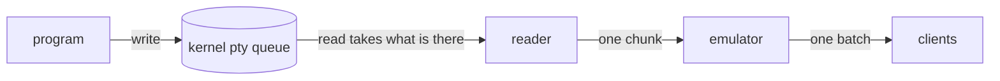
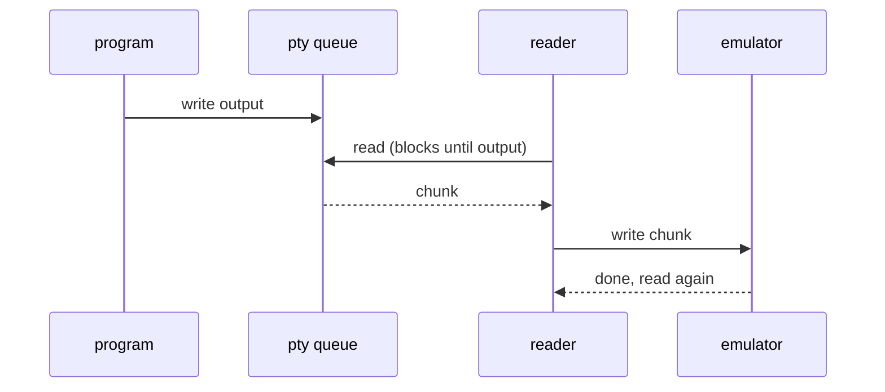
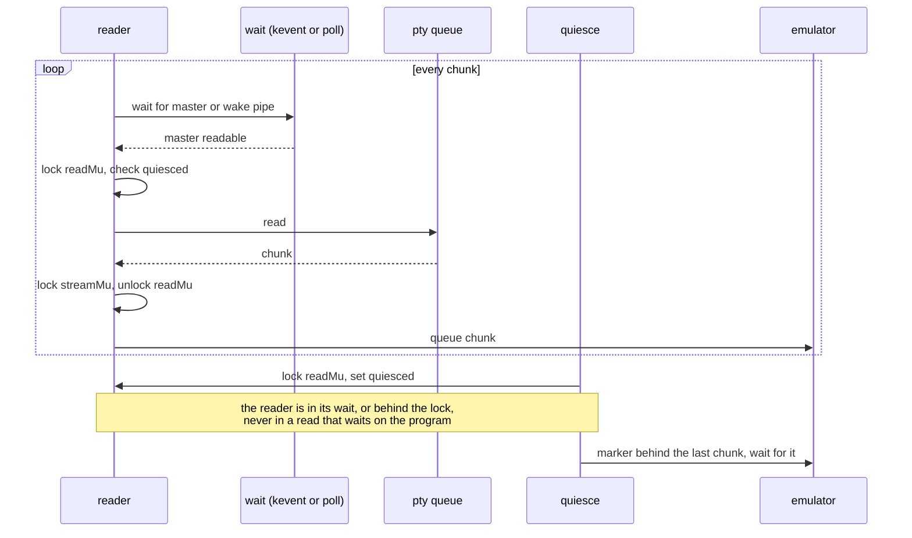
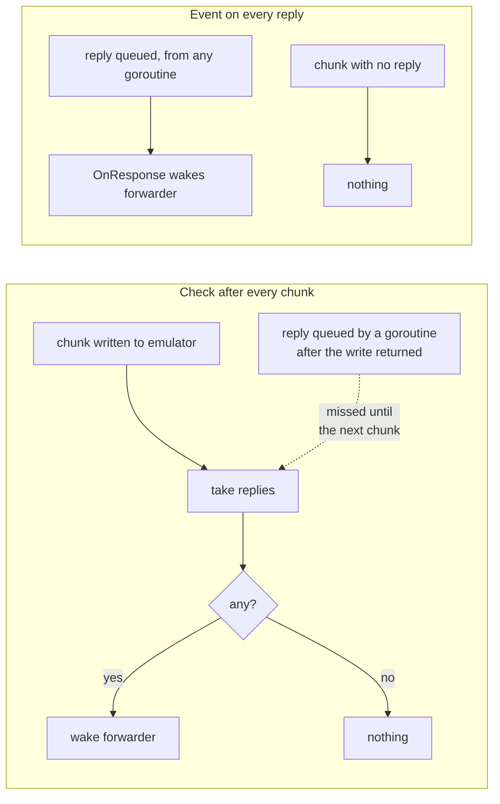
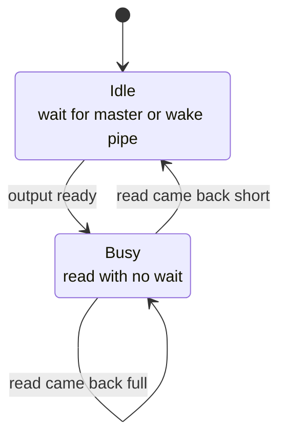
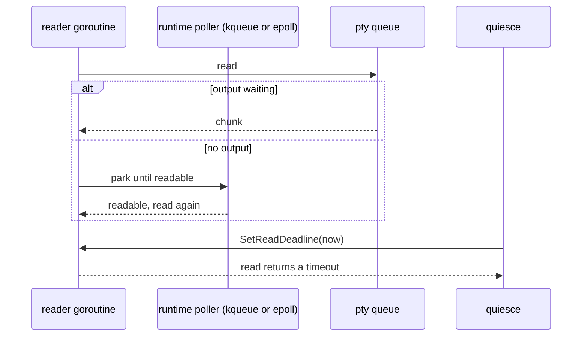

# The pane read path and how a live handoff pauses it

A pane's output travels from the program, through the pty (pseudo-terminal), to the daemon's reader, the terminal emulator, and every attached client. A live handoff (`docs/design/live-handoff.md`, section 2.4) pauses that reader, a quiesce, so the pane can be handed to a new daemon image without losing or duplicating a byte. This note describes the read path, what the pause costs a flood of output on each platform, and the designs that were measured for it.

The design in use:

- The reader waits for output outside `readMu` and reads under it, so a quiesce never waits on a quiet program.
- On macOS and the BSDs the wait is one `kevent(2)` on a kqueue each pane keeps, with the master and a wake pipe registered once. On Linux it is a `poll(2)` of the same two descriptors.
- The emulator wakes the reply forwarder through `OnResponse` each time it queues a reply, wherever the reply comes from. A flood that asks for nothing does no reply work.
- A flood through a pane costs what it costs without the pause, within the noise of the measurement (see Numbers).

## What a read is

The program writes into the pty. The kernel holds those bytes in a small queue until the reader takes them. A `read` returns whatever is in the queue at that moment, up to the size asked for, and does not wait for more.

The size of a read is set by the kernel, not by the reader's buffer. The reader asks for 16 KiB:

- On macOS the terminal's output queue holds about 1 KiB, and a program that fills it waits in `write` until the reader drains it. 98.4% of reads during a flood are 1024 to 2047 bytes and the average is 1016, on main and on the branch alike. The reader drains the queue on every read: a non-blocking read straight after one finds nothing in 99.6% of tries. So the reader waits, and is woken, once per KiB.
- On Linux reads average 620 to 860 bytes, and a non-blocking read straight after one finds more output waiting 99% of the time: the pty moves output in the background, so the queue refills while the reader works.

Every read has a fixed cost: the system calls, a lock, one write into the emulator, and its share of a client batch. On macOS a flood pays it about a thousand times per MB, so one extra system call per read is about a millisecond of CPU per MB.

## The reader on main: one blocking read per chunk

The reader spends its idle time blocked inside `read`. A read cannot be interrupted: the master is in blocking mode, a read deadline is ignored, and closing the descriptor does not wake it (`docs/design/live-handoff.md`, section 2.4). A reader that held a lock across that read would make a quiesce wait for the program to print.

## The reader with the read gate

The reader waits outside the lock, so a quiesce can always take `readMu`. The wait reports the master readable only when it is, so the read under the lock never blocks for long. `Close` writes the wake pipe to end the wait for good.

The wait is one system call per read that main does not make. What it costs depends on the call:

- `poll(2)` on macOS builds a kqueue, registers each descriptor, waits, and tears the kqueue down, on every call. With output ready it takes 631 ns, against 186 ns for `kevent(2)` on a kqueue with the same two descriptors registered once (200,000 calls each, M5 Pro). In a CPU profile of the flood below, `unix.Poll` is 21% of the samples, the sleep and wake included that main pays inside `read`.
- `poll(2)` on Linux keeps nothing between calls and costs a flood about a third of a millisecond per MB.

So the gate keeps a kqueue per pane on macOS and the BSDs (`internal/session/pty_gate_kqueue.go`) and polls on Linux and the other systems (`internal/session/pty_gate_poll.go`). The kqueue is made under `syscall.ForkLock` and closed on exec, so a handoff does not carry it into the new image. Closing the master drops its registration, so a descriptor number the master gave up is never watched.

## The reply forwarder: an event, not a check

Some programs ask the terminal a question (its size, its colours, whether a kitty upload worked) and wait for the answer. The emulator queues the answers, and a forwarder writes them to the program.

A check after each write misses a reply queued from anywhere else: the mode 2048 report of a cell size change, the mode 2031 report of a colour scheme switch, and the answer to a kitty upload from a file, which a goroutine queues once the file has been looked at. Each would wait until the program next prints, and a program waiting for its answer never does. `OnResponse` (`vt.Terminal`) calls a function each time a reply lands in the queue, on the goroutine that queued it, with the queue's lock released. Each pane sets it to wake the forwarder. The forwarder and a quiesce take and write the replies under `respMu`, so the replies keep their order and a quiesce can flush them.

## Per platform

| Platform | The wait | Quiesce | Checked |
| --- | --- | --- | --- |
| macOS | `kevent` on the pane's kqueue | yes | unit and e2e tests, negative controls, the flood numbers below |
| FreeBSD and the other BSDs | `kevent`, the same code | yes | `GOOS=freebsd go build ./...`, and the session package for NetBSD and OpenBSD. Not run |
| Linux | `poll` | yes | the gate's unit test and `TestQuiesceAfterBurstDoesNotWait` with its negative control, in Docker (Linux 6.8, arm64) |
| Windows | none: a ConPTY is not a descriptor to wait on (`pty_gate_other.go`) | no: `Quiesce` returns `errNotQuiescable` and a handoff is refused. The reader reads as on main | `GOOS=windows go build ./...` |
| Browser build (js) | none | no | `cmd/tuios-wasm/build.sh` |

The reply forwarder works the same way on every platform.

## Numbers

Apple M5 Pro, macOS 27, Go 1.26.10, `nice -n 10`, with other work on the machine. A scratch benchmark, not committed, cats a 64 MiB file of 100-column lines through a pane of a real daemon into one attached `TUIClient`, on the rig of `internal/session/wire_e2e_bench_test.go` (`newE2ERig`), three files a run at `-test.cpu 4`. CPU is getrusage of the test process, which holds the daemon and the client. Test binaries ran in alternating order, 14 runs each, at a load average of 4.7 to 6.1. Figures are medians, with the interquartile range in brackets.

| 64 MiB through a pane | main | poll per read | kqueue per pane (in use) |
| --- | ---: | ---: | ---: |
| throughput, MB/s | 109.8 (107.6–110.9) | 101.5 (97.6–103.4) | 108.3 (105.7–110.2) |
| CPU per MB, ms | 18.4 (18.2–18.9) | 19.7 (19.4–20.6) | 18.5 (18.2–18.8) |
| client batches per file | 604 | 656 | 621 |

A build with no wait at all, which cannot quiesce, measured 108.3 MB/s and 19.0 ms per MB against main's 107.1 and 19.2 in its own rotation (load 3.5 to 10.7): the whole difference was the wait. The client batches follow the reader's speed, not the size of its reads, which is the same on every build.

A second microbenchmark reads `cat` of the same file straight from a pty master with no daemon, two to five runs per design, reader CPU in ms per MB:

| Design | macOS | Linux (Docker) |
| --- | ---: | ---: |
| blocking read, as on main | 3.0–3.5 | 2.5–2.6 |
| poll, then read | 4.3–5.5 | 2.9 |
| kevent on a kqueue kept per pane, then read | 3.4–4.8 | no kqueue |
| non-blocking read, poll only when it finds nothing | 4.6–6.0 | 2.6 |
| non-blocking master in Go's runtime poller | 4.1–4.8 | 2.5–2.6 |

## Designs measured and not used

### Read again without waiting after a full read

Keep reading while reads come back full, since more output is almost certainly waiting, and wait again only after a short read.

A read never fills the buffer on either system: the kernel hands over at most about 1 KiB on macOS and under 1 KiB on average on Linux. So the busy state is never entered. Lowering the buffer to the kernel's size to make "full" mean something would tie the reader to a kernel constant, and a read that came back full with nothing behind it would block under `readMu`. A non-blocking read closes that hole, but on macOS the queue is empty after 99.6% of reads, so it adds a failed read to every wait. And it needs the master in non-blocking mode, below.

### Go's runtime poller

Put the master in non-blocking mode and read it through an `*os.File` the runtime polls, so the reader parks in the runtime's kqueue or epoll and a quiesce interrupts it with `SetReadDeadline(time.Now())`.

It works on both systems: a non-blocking duplicate of the master wrapped by `os.NewFile` is polled (the os package's special cases on darwin cover regular files, directories and FIFOs, not character devices), accepts a deadline, and reads a flood and its end correctly, on macOS and on Linux. It was not used because:

- On macOS it saves nothing over `poll`. The queue is empty after each read, so every read becomes a read that finds nothing, a park, a wake and a read again.
- Non-blocking mode belongs to the open file, so it reaches the `*os.File` xpty keeps, which the runtime does not poll. A write of the program's input or of a reply would fail with `EAGAIN` whenever the program's input queue is full. Every write path would have to move to the polled file, and a handoff's new image adopts the master in that mode too.
- On Linux, where it would save the poll, the poll costs about a third of a millisecond per MB.

### A flag between reads

A quiesce sets an atomic flag the reader checks between reads, which costs a memory load. It cannot get a reader out of a read that waits on a quiet program, so it needs a wait in front of the read anyway, and the wait is the cost. The gate's check of `quiesced` under an uncontended `readMu` already costs nothing measurable.

### Batch reads before the emulator

Read until a read comes back short, then write the batch into the emulator once, for fewer client batches. Read sizes are set by the kernel, and the extra client batches with the poll were a symptom of the slower reader: they went with it (604, 656, 621 above). Holding output back to batch it adds latency to every pane for no measured gain.
